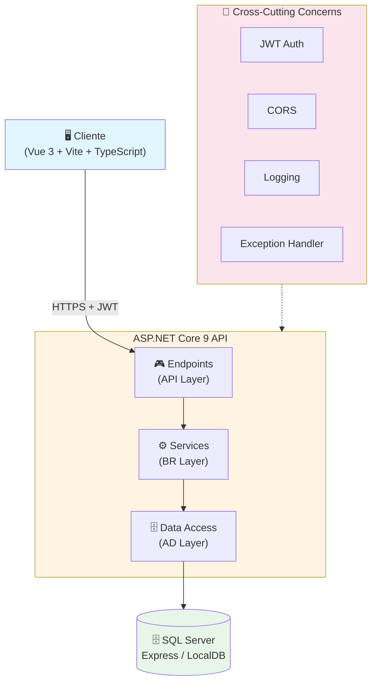
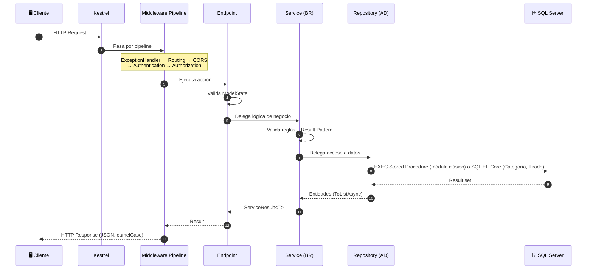

# Visión General de la Arquitectura

## Resumen

El backend del **Sistema Industrial** es una **API REST** construida con **ASP.NET Core 9** que expone endpoints para la gestión de producción industrial. Sigue una arquitectura **N-Tier (3 capas)** con separación clara de responsabilidades: **AD (Data Access)** → **BR (Business Rules)** → **API (Presentation)**.

## Diagrama de Alto Nivel



## Estructura de Capas (N-Tier)

| Capa | Proyecto | Responsabilidad | Tecnologías |
|------|----------|-----------------|-------------|
| **API** | `SistemaIndustrial.API` | Endpoints, Middleware, DI, Config, Global Exception Handler, JWT | ASP.NET Core 9, JWT, CORS |
| **BR** | `SistemaIndustrial.BR` | Business Logic, Validaciones, Orquestación, Result Pattern | BCrypt, DTOs, Interfaces |
| **AD** | `SistemaIndustrial.AD` | Data Access, Repositorios, SQL, doble patrón: SPs vía `SpInvoker` (módulo clásico) y EF Core directo (Categoría, Tirado) | `Microsoft.Data.SqlClient`, EF Core 9 |

## Principios de Diseño

| Principio | Implementación |
|-----------|----------------|
| **Separation of Concerns** | Endpoints (API) → Services (BR) → Repositories (AD) |
| **Dependency Inversion** | Interfaces `ISemanaRepository`, `ISemanaService`, `IAuthService` |
| **Single Responsibility** | Un servicio por entidad, un endpoint group por recurso |
| **DRY** | `SpInvoker` base + Repositorios tipados con helpers reutilizables |
| **Security by Default** | JWT Bearer configurado; **modo demo actual**: `RequireAuthorization` comentado en los endpoints (acceso libre) |
| **Fail Fast** | Validaciones tempranas, excepciones tipadas (`EntityNotFoundException`, `PersistenceException`, `UnauthorizedAccessException`) |
| **Layer Isolation** | Endpoints (API) solo usan DTOs e interfaces BR; `Program.cs` es el único punto que referencia AD (registro DI) |

## Tecnologías Principales (Versiones Exactas)

| Componente | Tecnología | Versión |
|------------|------------|---------|
| Framework | ASP.NET Core | 9.0 |
| Base de Datos | SQL Server (Express / LocalDB) | 2022+ |
| Data Access | EF Core + ADO.NET (`Microsoft.Data.SqlClient`) | 9.0 / 5.2+ |
| Auth | JWT Bearer Tokens | 9.0.5 |
| Hashing | BCrypt.Net-Next | 4.0.3 (workFactor: 12) |
| API Docs | OpenAPI nativo .NET 9 + Scalar (solo Development) | 9.0 |
| Serialización | System.Text.Json | Built-in (CamelCase) |
| Testing | MSTest + Moq | 3.6+ / 4.20+ |

## Flujo de Request Típico



## Convenciones de Código

- **Naming**: PascalCase para tipos/miembros públicos, camelCase para parámetros/privados
- **Async**: Todas las operaciones I/O son `async`/`await` (incluido `SpInvoker`, que usa `OpenAsync`/`ExecuteReaderAsync`/`ExecuteScalarAsync`/`ExecuteNonQueryAsync`)
- **Nullability**: `<Nullable>enable</Nullable>` en csproj
- **Records**: Para DTOs inmutables en BR (`LoginRequest`, `SemanaCreateDto`, `TiradoProductoBulkCreateDto`); clases con DataAnnotations en API (`ApiModels.cs`)
- **Interfaces**: Prefijo `I` (`IRepository`, `ISemanaService`, `IAuthService`, `ITiradoProductoService`, `IProductoCatalogoService`)
- **Result Pattern**: `ServiceResult<T>` para respuestas de servicios con éxito/fallo tipados
- **Response Wrapper**: `ApiResponse<T>` en endpoints (camelCase JSON)

## Configuración Real (appsettings)

```json
// appsettings.Development.json (SQL Auth + JWT)
{
  "ConnectionStrings": {
    "SqlServer": "Server=localhost;Database=SistemaIndustrialDB;User Id=industrial_user;Password=Industrial2026;TrustServerCertificate=True;"
  },
  "Jwt": {
    "Key": "SistemaIndustrial@JWT#2026!ClaveSecretaMuyLarga$ParaFirmarTokens*32chars",
    "Issuer": "SistemaIndustrial",
    "Audience": "SistemaIndustrialClient"
  },
  "Cors": {
    "AllowedOrigins": ["http://localhost:5173", "http://localhost:5174", "http://localhost:4173"]
  }
}
```

```json
// appsettings.json (LocalDB - Windows Auth)
{
  "ConnectionStrings": {
    "SqlServer": "Server=(localdb)\\MSSQLLocalDB;Database=SistemaIndustrialDB;Trusted_Connection=True;TrustServerCertificate=True;"
  },
  "Jwt": {
    "Key": "SistemaIndustrial@JWT#2026!ClaveSecretaMuyLarga$ParaFirmarTokens*32chars",
    "Issuer": "SistemaIndustrial",
    "Audience": "SistemaIndustrialClient"
  }
}
```