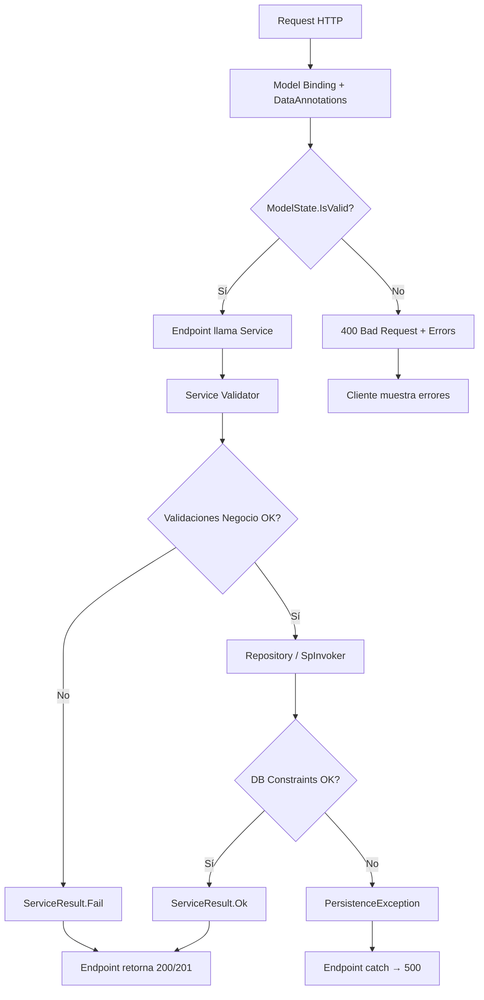

# Validaciones

## Niveles de Validación

| Nivel | Ubicación | Tipo | Ejemplo |
|-------|-----------|------|---------|
| **1. Cliente (Frontend)** | Vue components | UX inmediata | Required, email format, min length |
| **2. API (Model Binding)** | `SistemaIndustrial.API/Models/` | DataAnnotations | `[Required]`, `[Range]`, `[EmailAddress]` |
| **3. Servicio (BR Layer)** | `SistemaIndustrial.BR/Services/` | Lógica de negocio | Unicidad, integridad referencial, reglas complejas |
| **4. Base de Datos** | SQL Server | Constraints | PK, FK, UNIQUE, CHECK |

---

## Validaciones Declarativas (Data Annotations)

### API Models (`SistemaIndustrial.API/Models/ApiModels.cs`)

```csharp
// Usuario/Login
[Required, EmailAddress, StringLength(255)]
public string Email { get; set; }

[Required, StringLength(100, MinimumLength = 8)]
public string Password { get; set; }

// Semana
[Required, Range(1, 53, ErrorMessage = "Número de semana debe ser entre 1 y 53")]
public int NumeroSemana { get; set; }

[Required, Range(2020, 2030)]
public int Anio { get; set; }

[Required]
public DateTime FechaInicio { get; set; }

[Required]
public DateTime FechaFin { get; set; }

[Required, StringLength(20)]
[RegularExpression("^(Planificada|EnProgreso|Completada|Cancelada)$", ErrorMessage = "Estado inválido")]
public string Estado { get; set; }

// Categoría
[Required, StringLength(100)]
public string Nombre { get; set; }

[Range(0, int.MaxValue)]
public int Orden { get; set; }

// TiradoProducto
[Required, StringLength(200)]
public string Nombre { get; set; }

[Required, Range(0.01, double.MaxValue)]
public decimal PedidoSemanal { get; set; }

[Required, Range(0.01, double.MaxValue)]
public decimal PromedioPorTacho { get; set; }

[Range(0, double.MaxValue)]
public decimal StockInicial { get; set; }

// RegistrarTirada
[Required, Range(0.01, double.MaxValue)]
public decimal Cantidad { get; set; }

// ProductoCatalogo
[Required, StringLength(200)]
public string Nombre { get; set; }

[Range(0, double.MaxValue)]
public decimal PedidoSemanalAproximado { get; set; }

// Insumo
[Required, StringLength(200)]
public string Nombre { get; set; }

[Required, StringLength(50)]
public string UnidadMedida { get; set; }

[Range(0, double.MaxValue)]
public decimal CantidadRequerida { get; set; }

// Stock
[Required, StringLength(200)]
public string Producto { get; set; }

[Range(0, double.MaxValue)]
public decimal StockInicial { get; set; }

// Registro Tacho (código existente, endpoint no mapeado)
[Required, Range(1, 3, ErrorMessage = "Turno debe ser 1, 2 o 3")]
public int Turno { get; set; }

[Required, StringLength(100)]
public string Operador { get; set; }

[Range(0, double.MaxValue)]
public decimal CantidadProducida { get; set; }

[Required, StringLength(20)]
[RegularExpression("^(Aprobado|Revision|Rechazado)$")]
public string EstadoCalidad { get; set; }
```

---

## Validaciones Imperativas (BR Layer Services)

### SemanaService
```csharp
public async Task<ServiceResult<SemanaResponse>> CreateAsync(SemanaCreateDto dto)
{
    // 1. Validaciones de negocio (incluye lunes-sábado, 6 días exactos)
    var validation = SemanaValidator.ValidateCreate(dto);
    if (!validation.Success)
        return ServiceResult<SemanaResponse>.Fail(validation.Message!);

    // 2. Validación cruzada: no duplicados (número + año)
    if (await _repository.ExistsByNumeroAnioAsync(dto.NumeroSemana, dto.Anio))
        return ServiceResult<SemanaResponse>.Fail($"Ya existe una semana {dto.NumeroSemana} del año {dto.Anio}.");

    // 3. Crear entidad (Estado inicial siempre "Planificada") y persistir
    var entity = new Semana { /* mapeo */ };
    var created = await _repository.CreateAsync(entity);
    return ServiceResult<SemanaResponse>.Ok(MapToResponse(created), "Semana creada correctamente.");
}

public async Task<ServiceResult> DeleteAsync(int id)
{
    var existing = await _repository.GetByIdAsync(id);
    if (existing == null)
        return ServiceResult.Fail($"La semana con Id {id} no existe.");

    // Validación cruzada vía SP: no eliminar si tiene datos dependientes
    if (await _repository.HasDependentDataAsync(id))
        return ServiceResult.Fail("No se puede eliminar la semana porque tiene datos asociados (insumos, stock, tirado).");

    await _repository.DeleteAsync(id);
    return ServiceResult.Ok("Semana eliminada correctamente.");
}
```

### TiradoProductoService
```csharp
public async Task<ServiceResult<TiradoProductoResponse>> CreateAsync(TiradoProductoCreateDto dto)
{
    // 1. Validaciones de negocio (nombre, unidad, pedido > 0, stock >= 0, promedio > 0)
    var validation = TiradoProductoValidator.ValidateCreate(dto);
    if (!validation.Success)
        return ServiceResult<TiradoProductoResponse>.Fail(validation.Message!);

    // 2. Semana y categoría (opcional) deben existir
    if (!await _semanaRepository.ExistsAsync(dto.SemanaId))
        return ServiceResult<TiradoProductoResponse>.Fail($"La semana con Id {dto.SemanaId} no existe.");

    if (dto.CategoriaId.HasValue && !await _categoriaRepository.ExistsAsync(dto.CategoriaId.Value))
        return ServiceResult<TiradoProductoResponse>.Fail($"La categoría con Id {dto.CategoriaId.Value} no existe.");

    // 3. No duplicados (Nombre + SemanaId, índice único)
    if (await _repository.ExistsByNombreSemanaAsync(dto.Nombre, dto.SemanaId))
        return ServiceResult<TiradoProductoResponse>.Fail($"Ya existe un producto '{dto.Nombre}' para esta semana.");

    // ... crear entidad (CantidadTirada = 0, Stock = 0) y persistir
}

public async Task<ServiceResult<TiradoProductoBulkResultDto>> CreateBulkAsync(int semanaId, TiradoProductoBulkCreateDto dto)
{
    // Valida semana existente y lista no vacía; por cada item valida
    // nombre, promedio > 0, stock/pedido no negativos, categoría existente
    // y duplicados. Los inválidos se ignoran con conteo en Ignorados + Errores
    // (no falla toda la operación).
}
```

### StockService (Fórmula automática + SyncFromTirado)
```csharp
public async Task<ServiceResult<StockSemana>> UpdateAsync(int id, StockUpdateDto dto)
{
    var entity = await _repository.GetByIdAsync(id);
    if (entity == null) return ServiceResult<StockSemana>.Fail("Stock no encontrado.");
    
    // Validaciones
    if (dto.StockInicial < 0 || dto.Entradas < 0 || dto.Salidas < 0)
        return ServiceResult<StockSemana>.Fail("Los valores no pueden ser negativos.");
    
    // Calcular StockFinal automáticamente
    entity.StockInicial = dto.StockInicial;
    entity.Entradas = dto.Entradas;
    entity.Salidas = dto.Salidas;
    entity.StockFinal = dto.StockInicial + dto.Entradas - dto.Salidas;
    entity.Producto = dto.Producto;
    entity.UnidadMedida = dto.UnidadMedida;
    
    await _repository.UpdateAsync(id, entity);
    return ServiceResult<StockSemana>.Ok(entity);
}
```

### SyncFromTirado (StockService)
```csharp
public async Task<ServiceResult<List<StockResponse>>> SyncFromTiradoAsync(int semanaId)
{
    // 1. La semana debe existir
    // 2. Lee productos de Tirado de la semana (ITiradoProductoService)
    // 3. Crea StockSemana (StockInicial = Tirado.StockInicial) solo para
    //    nombres que aún no existen (comparación case-insensitive)
    // 4. Retorna el stock final de la semana + mensaje
    //    ("N productos sincronizados desde Tirado." o "Todos los productos ya estaban sincronizados.")
}
```

### CategoriaService / ProductoCatalogoService
```csharp
// Categoria: nombre obligatorio (máx. 100), orden >= 0 (CategoriaValidator)
// ProductoCatalogo: nombre obligatorio (máx. 200), unidad obligatoria,
//   pedido/promedio >= 0, observaciones máx. 500 (ProductoCatalogoValidator)
// Ambos validan unicidad de nombre (ExistsByNombre / ExistsByNombreAsync)
// antes de crear/actualizar.
```

### AuthService
```csharp
public async Task<ServiceResult<LoginResponse>> LoginAsync(LoginRequest request)
{
    // 1. Validar entrada básica
    if (string.IsNullOrWhiteSpace(request.Email) || string.IsNullOrWhiteSpace(request.Password))
        return ServiceResult<LoginResponse>.Fail("Email y contraseña son requeridos.");
    
    // 2. Buscar usuario
    var user = await _usuarioRepository.GetByEmailAsync(request.Email.Trim().ToLower());
    if (user == null)
        return ServiceResult<LoginResponse>.Fail("Credenciales inválidas."); // Genérico por seguridad
    
    // 3. Verificar activo
    if (!user.Activo)
        return ServiceResult<LoginResponse>.Fail("Usuario inactivo.");
    
    // 4. Verificar password (BCrypt)
    if (!BCrypt.Net.BCrypt.Verify(request.Password, user.PasswordHash))
        return ServiceResult<LoginResponse>.Fail("Credenciales inválidas.");
    
    // 5. Generar tokens
    var token = GenerateJwtToken(user);
    var refreshToken = GenerateRefreshToken();
    
    // 6. Guardar refresh token hash
    await _usuarioRepository.UpdateRefreshTokenAsync(user.Id, BCrypt.Net.BCrypt.HashPassword(refreshToken), DateTime.UtcNow.AddDays(7));
    
    return ServiceResult<LoginResponse>.Ok(new LoginResponse(
        token, refreshToken, DateTime.UtcNow.AddHours(8),
        new UserInfo(user.Id, user.Email, user.Nombre, user.Role)));
}
```

---

## Flujo de Validación Completo



---

## Reglas de Negocio Principales

| Entidad | Regla | Capa |
|---------|-------|------|
| Semana | Número 1-53, Año 2020-2030 | API + BR |
| Semana | Inicio lunes, fin sábado, duración exacta 6 días | BR (`SemanaValidator.ValidarFechasSemana`) |
| Semana | No duplicados (NumeroSemana + Anio) | BR |
| Semana | No eliminar si `HasDependentDataAsync` (insumos, stock, tirado) | BR |
| TiradoProducto | Pedido > 0, PromedioPorTacho > 0, Stock >= 0, nombre único por semana | BR |
| TiradoProducto | Bulk: items inválidos se ignoran (no falla todo) | BR |
| Categoria | Nombre único, orden >= 0 | BR |
| ProductoCatalogo | Nombre único, pedido/promedio >= 0 | BR |
| Insumo | Cantidades ≥ 0 | BR |
| Stock | StockFinal = Inicial + Entradas - Salidas (auto) | BR |
| Stock | SyncFromTirado crea faltantes sin duplicar | BR |
| RegistroTacho | Turno 1-3, Cantidades ≥ 0 (código sin endpoint mapeado) | BR |
| Usuario | Email único, Activo=1 para login | BR |
| Auth | Password ≥ 8 chars, BCrypt workFactor 12 | BR |
| JWT | Expiración 8h, Refresh 7d, Rotación | BR |