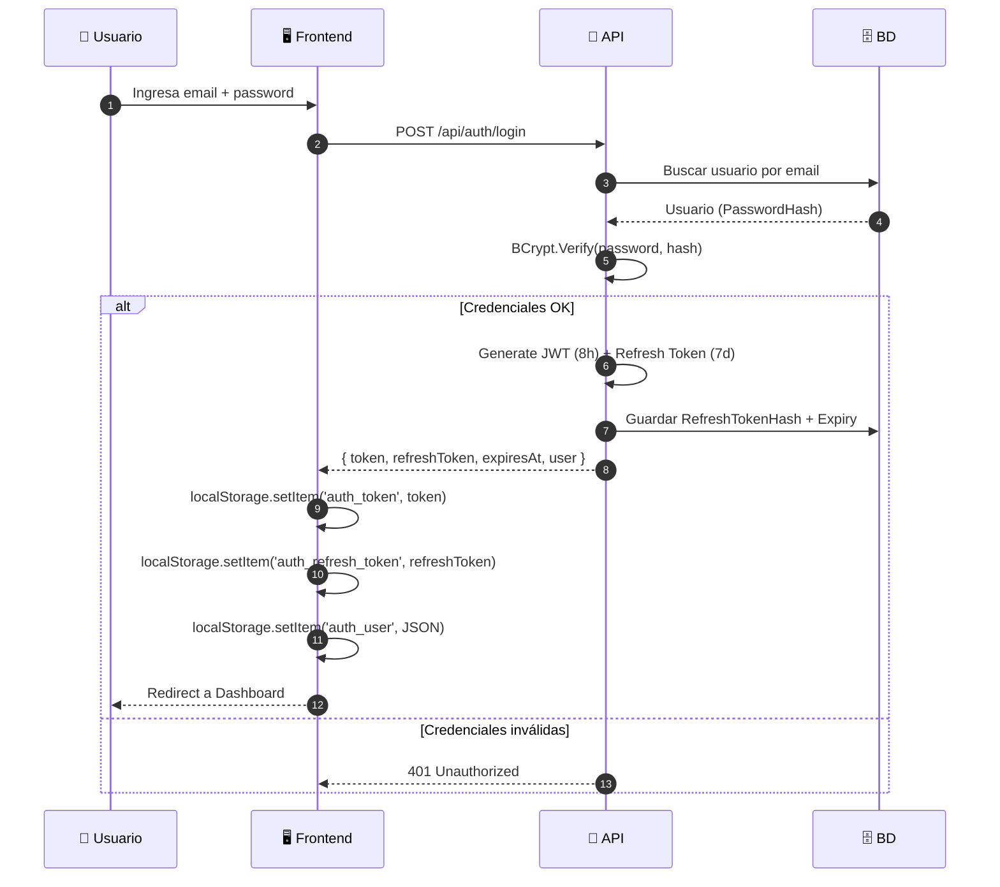

# JWT Authentication

## Visión General

El sistema implementa autenticación **stateless** usando **JWT (JSON Web Tokens)** con **Refresh Tokens** para equilibrio entre seguridad y experiencia de usuario.

---

## Flujo de Autenticación



---

## Access Token (JWT)

### Características
- **Algoritmo**: HMAC-SHA256 (HS256)
- **Expiración**: 8 horas
- **Claims estándar**: `sub` (userId), `email`, `name`, `role`, `iss`, `aud`, `exp`, `iat`
- **Tamaño típico**: ~500-800 chars

### Claims
```json
{
  "sub": "1",
  "email": "admin@industrial.com",
  "name": "Administrador",
  "role": "Admin",
  "iss": "SistemaIndustrial",
  "aud": "SistemaIndustrialClient",
  "exp": 1760112000,
  "iat": 1760083200
}
```

### Generación (AuthService)
```csharp
private string GenerateJwtToken(Usuario user)
{
    var key = new SymmetricSecurityKey(Encoding.UTF8.GetBytes(_configuration["Jwt:Key"]!));
    var creds = new SigningCredentials(key, SecurityAlgorithms.HmacSha256);
    
    var claims = new[]
    {
        new Claim(ClaimTypes.NameIdentifier, user.Id.ToString()),
        new Claim(ClaimTypes.Email, user.Email),
        new Claim(ClaimTypes.Name, user.Nombre),
        new Claim(ClaimTypes.Role, user.Role),
    };
    
    var token = new JwtSecurityToken(
        issuer: _configuration["Jwt:Issuer"],
        audience: _configuration["Jwt:Audience"],
        claims: claims,
        expires: DateTime.UtcNow.AddHours(8),
        signingCredentials: creds
    );
    
    return new JwtSecurityTokenHandler().WriteToken(token);
}
```

---

## Refresh Token

### Características
- **Formato**: Base64 URL-safe (64 bytes random → ~88 chars)
- **Expiración**: 7 días
- **Rotación**: Nuevo refresh token en cada uso
- **Almacenamiento BD**: `RefreshTokenHash` (BCrypt) + `RefreshTokenExpiry`

### Generación
```csharp
private string GenerateRefreshToken()
{
    var randomBytes = new byte[64];
    using var rng = RandomNumberGenerator.Create();
    rng.GetBytes(randomBytes);
    return Convert.ToBase64String(randomBytes)
        .Replace('+', '-').Replace('/', '_').TrimEnd('='); // URL-safe
}
```

### Almacenamiento Seguro
```csharp
// En Login / Refresh
var refreshTokenHash = BCrypt.Net.BCrypt.HashPassword(refreshToken, 12);
await _usuarioRepository.UpdateRefreshTokenAsync(user.Id, refreshTokenHash, DateTime.UtcNow.AddDays(7));
```

### Validación (Refresh Endpoint)
```csharp
public async Task<ServiceResult<LoginResponse>> RefreshTokenAsync(RefreshTokenRequest request)
{
    // Buscar usuario con refresh token válido
    // NOTA: Requiere índice o tabla separada para performance
    var user = await _usuarioRepository.GetByRefreshTokenHashAsync(request.RefreshToken);
    
    if (user == null || user.RefreshTokenExpiry <= DateTime.UtcNow)
        return ServiceResult<LoginResponse>.Fail("Refresh token inválido o expirado.");
    
    // Verificar hash
    if (!BCrypt.Net.BCrypt.Verify(request.RefreshToken, user.RefreshTokenHash!))
        return ServiceResult<LoginResponse>.Fail("Refresh token inválido.");
    
    // Generar nuevos tokens (rotación)
    var newAccessToken = GenerateJwtToken(user);
    var newRefreshToken = GenerateRefreshToken();
    var newRefreshHash = BCrypt.Net.BCrypt.HashPassword(newRefreshToken, 12);
    
    await _usuarioRepository.UpdateRefreshTokenAsync(user.Id, newRefreshHash, DateTime.UtcNow.AddDays(7));
    
    return ServiceResult<LoginResponse>.Ok(new LoginResponse(
        newAccessToken, newRefreshToken, DateTime.UtcNow.AddHours(8),
        new UserInfo(user.Id, user.Email, user.Nombre, user.Role)));
}
```

---

## Configuración JWT (Program.cs)

```csharp
builder.Services.AddAuthentication(JwtBearerDefaults.AuthenticationScheme)
    .AddJwtBearer(options =>
    {
        options.TokenValidationParameters = new TokenValidationParameters
        {
            ValidateIssuer = true,
            ValidateAudience = true,
            ValidateLifetime = true,
            ValidateIssuerSigningKey = true,
            ValidIssuer = builder.Configuration["Jwt:Issuer"],
            ValidAudience = builder.Configuration["Jwt:Audience"],
            IssuerSigningKey = new SymmetricSecurityKey(
                Encoding.UTF8.GetBytes(builder.Configuration["Jwt:Key"]!)),
            ClockSkew = TimeSpan.FromMinutes(1) // Tolerancia reloj
        };
        
        // Eventos para logging/debug
        options.Events = new JwtBearerEvents
        {
            OnAuthenticationFailed = context =>
            {
                if (context.Exception.GetType() == typeof(SecurityTokenExpiredException))
                    context.Response.Headers.Append("Token-Expired", "true");
                return Task.CompletedTask;
            },
            OnTokenValidated = context =>
            {
                // Validaciones adicionales (usuario activo, etc.)
                return Task.CompletedTask;
            }
        };
    });

builder.Services.AddAuthorization(options =>
{
    // Policies futuras
    options.AddPolicy("RequireAdmin", policy => policy.RequireRole("Admin"));
    options.AddPolicy("RequireSupervisor", policy => policy.RequireRole("Admin", "Supervisor"));
    options.AddPolicy("RequireOperador", policy => policy.RequireRole("Admin", "Supervisor", "Operador"));
});
```

---

## Middleware Pipeline Order

```csharp
app.UseRouting();
app.UseCors("VueCors");
app.UseAuthentication();    // JWT validation → User principal
app.UseAuthorization();     // Policies, roles
app.MapEndpoints();
```

---

## Protección de Endpoints

### Global (Program.cs)
```csharp
// Requiere autenticación por defecto
var apiGroup = app.MapGroup("/api").RequireAuthorization();

// Endpoints públicos explícitos
var publicGroup = app.MapGroup("/api/auth").AllowAnonymous();
var healthGroup = app.MapGroup("/health").AllowAnonymous();
```

### Por Endpoint
```csharp
// En endpoint groups
semanaEndpoints.MapGet("/api/semanas", async (...) => ...)
    .RequireAuthorization(); // Default policy

// Con policy específica (futuro)
semanaEndpoints.MapPost("/api/semanas", async (...) => ...)
    .RequireAuthorization("RequireSupervisor");
```

### AllowAnonymous Explícito
```csharp
publicGroup.MapPost("/login", async (...) => ...).AllowAnonymous();
publicGroup.MapPost("/refresh", async (...) => ...).AllowAnonymous();
publicGroup.MapPost("/register", async (...) => ...).AllowAnonymous(); // Solo Dev/Admin
```

---

## Frontend Integration

### useAuth Composable
```typescript
// composables/useAuth.ts
const TOKEN_KEY = 'auth_token'
const REFRESH_TOKEN_KEY = 'auth_refresh_token'
const USER_KEY = 'auth_user'

export function useAuth() {
  const getToken = () => localStorage.getItem(TOKEN_KEY)
  const getRefreshToken = () => localStorage.getItem(REFRESH_TOKEN_KEY)
  const getUser = () => {
    const raw = localStorage.getItem(USER_KEY)
    if (!raw) return null
    try { return JSON.parse(raw) } catch { return null }
  }

  const isAuthenticated = () => !!getToken()

  const guardarSesion = (token: string, refreshToken: string, user: UserInfo) => {
    localStorage.setItem(TOKEN_KEY, token)
    localStorage.setItem(REFRESH_TOKEN_KEY, refreshToken)
    localStorage.setItem(USER_KEY, JSON.stringify(user))
  }

  const cerrarSesion = () => {
    localStorage.removeItem(TOKEN_KEY)
    localStorage.removeItem(REFRESH_TOKEN_KEY)
    localStorage.removeItem(USER_KEY)
  }

  const authHeaders = () => {
    const token = getToken()
    return token
      ? { 'Content-Type': 'application/json', Authorization: `Bearer ${token}` }
      : { 'Content-Type': 'application/json' }
  }

  return { getToken, getRefreshToken, getUser, isAuthenticated, guardarSesion, cerrarSesion, authHeaders }
}
```

### Route Guards
```typescript
// router/index.ts
router.beforeEach((to) => {
  const { isAuthenticated } = useAuth()
  const autenticado = isAuthenticated()

  if (to.meta.requiereAuth && !autenticado)
    return { name: 'login' }

  if (to.meta.soloInvitado && autenticado)
    return { name: 'home' }
  
  // Futuro: validación de roles
  if (to.meta.roles && !to.meta.roles.includes(getUser()?.role))
    return { name: 'home' }
})
```

### Auto-refresh Interceptor
```typescript
// composables/useApiFetch.ts
let isRefreshing = false
let refreshSubscribers: ((token: string) => void)[] = []

const refreshAccessToken = async () => {
  const refreshToken = localStorage.getItem(REFRESH_TOKEN_KEY)
  const res = await fetch(`${API}/api/auth/refresh`, {
    method: 'POST',
    headers: { 'Content-Type': 'application/json' },
    body: JSON.stringify({ refreshToken })
  })
  
  if (!res.ok) {
    useAuth().cerrarSesion()
    router.push('/login')
    throw new Error('Session expired')
  }
  
  const { data } = await res.json()
  localStorage.setItem(TOKEN_KEY, data.token)
  localStorage.setItem(REFRESH_TOKEN_KEY, data.refreshToken)
  return data.token
}

export async function apiFetch(url: string, options: RequestInit = {}) {
  const { authHeaders } = useAuth()
  const headers = { ...authHeaders(), ...options.headers }
  
  let res = await fetch(url, { ...options, headers })
  
  if (res.status === 401 && !url.includes('/auth/')) {
    if (!isRefreshing) {
      isRefreshing = true
      try {
        const newToken = await refreshAccessToken()
        isRefreshing = false
        refreshSubscribers.forEach(cb => cb(newToken))
        refreshSubscribers = []
        
        // Reintentar con nuevo token
        const newHeaders = { ...headers, Authorization: `Bearer ${newToken}` }
        res = await fetch(url, { ...options, headers: newHeaders })
      } catch {
        isRefreshing = false
        throw new Error('Token refresh failed')
      }
    } else {
      // Esperar refresh
      return new Promise((resolve) => {
        refreshSubscribers.push((token) => {
          resolve(fetch(url, { ...options, headers: { ...headers, Authorization: `Bearer ${token}` } }))
        })
      })
    }
  }
  
  return res
}
```

---

## Seguridad Adicional (Futuro)

| Mejora | Descripción |
|--------|-------------|
| **HttpOnly Cookies** | Mover tokens a cookies seguras (SameSite=Strict, Secure) |
| **Token Blacklist** | Redis para invalidar tokens antes de expiración (logout global) |
| **Device Fingerprinting** | Detectar uso anómalo de refresh tokens |
| **MFA** | Autenticación de dos factores para Admin |
| **Audit Log** | Registro de login/logout/intentos fallidos |
| **Rate Limiting** | 5 login/min/IP, 100 req/min/user |
| **Password Policy** | Complejidad, historial, expiración |