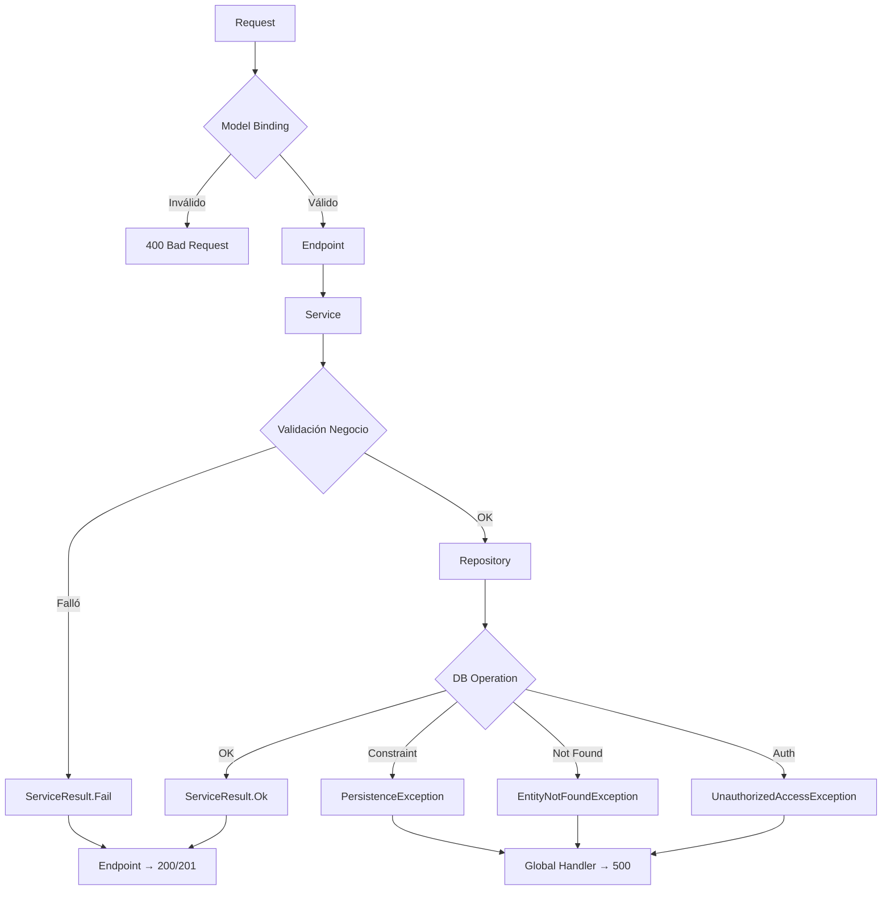

# Jerarquía de Excepciones

## Ubicación
`SistemaIndustrial.AD/Exceptions/`

---

## EntityNotFoundException

**HTTP Status**: 404 Not Found

```csharp
public class EntityNotFoundException : Exception
{
    public string EntityName { get; }
    public int EntityId { get; }
    
    public EntityNotFoundException(string message) : base(message) 
    { 
        EntityName = "Entidad";
        EntityId = 0;
    }
    
    public EntityNotFoundException(string entityName, int id) 
        : base($"{entityName} con Id {id} no fue encontrado.")
    {
        EntityName = entityName;
        EntityId = id;
    }
}
```

### Cuándo se lanza
- `GetByIdAsync` retorna null
- `UpdateAsync` / `DeleteAsync` en ID inexistente
- Validaciones cruzadas en BR (ej. SemanaId no existe en Objetivo)

### Ejemplos
```csharp
// En Repository
public async Task<Semana?> GetByIdAsync(int id)
{
    var list = await _spInvoker.QueryEntityAsync<Semana>("EXEC sp_Semanas_GetById @Id", new { Id = id });
    return list.FirstOrDefault();
}

// En Service
public async Task<ServiceResult<SemanaResponse>> GetByIdAsync(int id)
{
    var entity = await _repository.GetByIdAsync(id);
    if (entity == null) 
        return ServiceResult<SemanaResponse>.Fail($"Semana con Id {id} no encontrada.");
    // ...
}

// En Endpoint (ServiceResult ya manejado)
app.MapGet("/api/semanas/{id:int}", async (int id, ISemanaService service) =>
{
    var result = await service.GetByIdAsync(id);
    return result.Success 
        ? Results.Ok(ApiResponse<SemanaResponse>.Ok(result.Data!))
        : Results.NotFound(ApiResponse<object>.Fail(result.Message!));
});
```

---

## PersistenceException

**HTTP Status**: 500 Internal Server Error

```csharp
public class PersistenceException : Exception
{
    public PersistenceException(string message) : base(message) { }
    public PersistenceException(string message, Exception inner) : base(message, inner) { }
}
```

### Cuándo se lanza
- Error de conexión BD
- Timeout de query
- Violación de constraints (FK, UNIQUE, CHECK)
- Deadlock
- Error en SP

### Manejo en Repository
```csharp
public async Task<Semana> CreateAsync(Semana entity)
{
    try
    {
        var id = await _spInvoker.ScalarAsync("EXEC sp_Semanas_Create @NumeroSemana, @Anio, @FechaInicio, @FechaFin, @Estado", 
            new { entity.NumeroSemana, entity.Anio, entity.FechaInicio, entity.FechaFin, entity.Estado });
        entity.Id = Convert.ToInt32(id);
        return entity;
    }
    catch (SqlException ex) when (ex.Number == 2627 || ex.Number == 2601) // Unique constraint
    {
        throw new PersistenceException("Violación de constraint único (posible duplicado).", ex);
    }
    catch (SqlException ex)
    {
        throw new PersistenceException($"Error de base de datos: {ex.Message}", ex);
    }
    catch (Exception ex)
    {
        throw new PersistenceException($"Error inesperado al crear semana: {ex.Message}", ex);
    }
}
```

### Manejo en Endpoint (Global Exception Handler)
```csharp
app.UseExceptionHandler(errorApp =>
{
    errorApp.Run(async context =>
    {
        var exception = context.Features.Get<IExceptionHandlerFeature>()?.Error;
        
        context.Response.StatusCode = exception switch
        {
            EntityNotFoundException => 404,
            PersistenceException => 500,
            UnauthorizedAccessException => 401,
            _ => 500
        };
        
        context.Response.ContentType = "application/json";
        
        var response = new
        {
            success = false,
            message = exception switch
            {
                EntityNotFoundException => exception.Message,
                PersistenceException => "Error de base de datos. Intente nuevamente.",
                UnauthorizedAccessException => "No autorizado.",
                _ => "Ocurrió un error interno del servidor."
            },
            data = (object?)null,
            errors = (string[]?)null
        };
        
        await context.Response.WriteAsync(JsonSerializer.Serialize(response));
    });
});
```

---

## UnauthorizedAccessException

**HTTP Status**: 401 Unauthorized

```csharp
public class UnauthorizedAccessException : Exception
{
    public UnauthorizedAccessException(string message) : base(message) { }
}
```

### Cuándo se lanza
- Credenciales inválidas en Login
- Refresh token inválido/expirado
- Token JWT malformado/expirado
- Intento de acceso sin permisos (futuro)

### Ejemplo en AuthService
```csharp
public async Task<ServiceResult<LoginResponse>> LoginAsync(LoginRequest request)
{
    var user = await _usuarioRepository.GetByEmailAsync(request.Email.Trim().ToLower());
    if (user == null || !user.Activo)
        throw new UnauthorizedAccessException("Credenciales inválidas.");
    
    if (!BCrypt.Net.BCrypt.Verify(request.Password, user.PasswordHash))
        throw new UnauthorizedAccessException("Credenciales inválidas.");
    
    // ...
}
```

---

## Flujo de Manejo de Errores



---

## Formato de Respuesta de Error Unificado

Todas las respuestas de error siguen el mismo formato:

```json
{
  "success": false,
  "message": "Descripción legible del error",
  "data": null,
  "errors": ["detalle1", "detalle2"] // opcional, solo 400
}
```

### Mapeo Excepción → Response

| Excepción | Status | Message | Errors |
|-----------|--------|---------|--------|
| `EntityNotFoundException` | 404 | Message de la excepción | null |
| `PersistenceException` | 500 | "Error de base de datos. Intente nuevamente." | null |
| `UnauthorizedAccessException` | 401 | "No autorizado." / Message | null |
| `ArgumentException` / `ValidationException` | 400 | "Errores de validación" | Lista detalles |
| `Exception` (inesperada) | 500 | "Ocurrió un error interno del servidor." | null |

---

## Logging de Excepciones

```csharp
// En Global Exception Handler
app.UseExceptionHandler(errorApp =>
{
    errorApp.Run(async context =>
    {
        var exception = context.Features.Get<IExceptionHandlerFeature>()?.Error;
        
        // Log estructurado
        var logger = context.RequestServices.GetRequiredService<ILogger<Program>>();
        
        var logLevel = exception switch
        {
            EntityNotFoundException => LogLevel.Warning,
            PersistenceException => LogLevel.Error,
            UnauthorizedAccessException => LogLevel.Warning,
            _ => LogLevel.Error
        };
        
        logger.Log(logLevel, exception, 
            "Error en {Path}: {Message}", 
            context.Request.Path, exception?.Message);
        
        // ... respuesta JSON
    });
});
```

---

## Testing de Excepciones

```csharp
// Test: EntityNotFoundException → 404
[TestMethod]
public async Task GetSemana_NotFound_Returns404()
{
    // Arrange
    _mockRepo.Setup(r => r.GetByIdAsync(999)).ReturnsAsync((Semana?)null);
    
    // Act
    var result = await _service.GetByIdAsync(999);
    
    // Assert
    Assert.IsFalse(result.Success);
    Assert.AreEqual("Semana con Id 999 no encontrada.", result.Message);
}

// Test: PersistenceException en Create
[TestMethod]
public async Task CreateSemana_Duplicate_ThrowsPersistenceException()
{
    _mockSpInvoker.Setup(s => s.ScalarAsync(It.IsAny<string>(), It.IsAny<object>()))
        .Throws(new SqlException("Violation of UNIQUE KEY", new Exception(), 2627, false));
    
    await Assert.ThrowsExceptionAsync<PersistenceException>(
        () => _service.CreateAsync(new SemanaCreateDto(1, 2026, DateTime.Now, DateTime.Now.AddDays(7))));
}
```