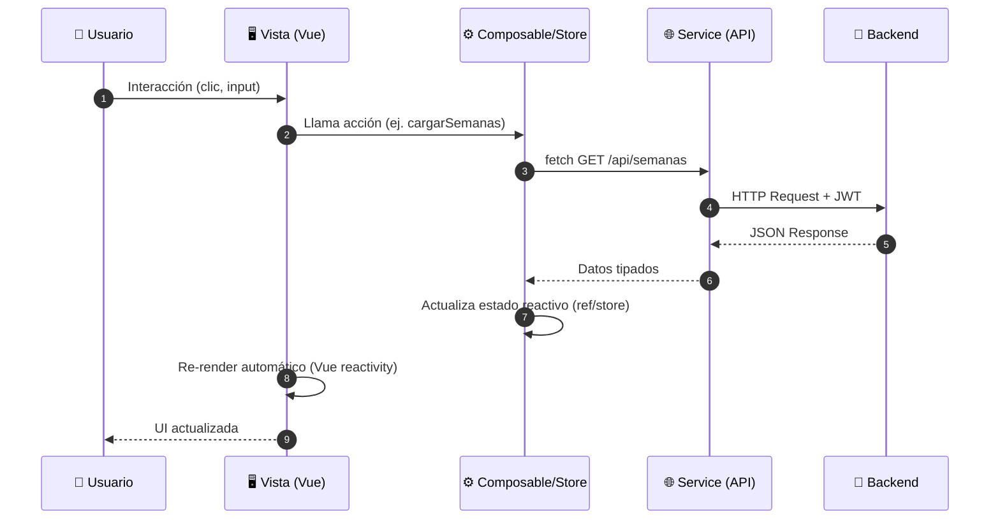

# Frontend - Visión General

## Descripción General

El frontend del **Sistema Industrial** es una **Single Page Application (SPA)** construida con **Vue 3** (Composition API + **TypeScript**) que sirve como panel de control para la gestión de producción industrial: semanas, insumos, stock, sectores Tirado/Armado, catálogo de productos y dashboard de métricas.

---

## Stack Tecnológico (Versiones Exactas)

### Producción
| Tecnología | Versión | Propósito |
|------------|---------|-----------|
| **Vue** | 3.5+ | Framework reactivo (Composition API + TypeScript) |
| **Vite** | 6.2+ | Bundler y dev server |
| **Vue Router** | 4.5+ | Enrutamiento SPA |
| **Pinia** | 3.0+ | Estado global |
| **Element Plus** | 2.14+ | Biblioteca de componentes UI |
| **@element-plus/icons-vue** | 1.1+ | Iconografía |

### Desarrollo
| Paquete | Versión | Propósito |
|---------|---------|-----------|
| **TypeScript** | 5.8+ | Tipado estático |
| **ESLint** | 9.39+ | Linting |
| **Prettier** | 3.8+ | Formato |
| **@vitejs/plugin-vue** | 5.2+ | Plugin Vue para Vite |
| **@vue/tsconfig** | Latest | Config TS base |

---

## Arquitectura General (Código Real)

```
Frontend/
├── src/
│   ├── components/       # Reutilizables (DataTable, FormField, SelectField, DatePickerField, KpiCard, ChartContainer, Modal, Spinner, NavBarUserMenu)
│   ├── composables/      # Lógica reactiva reutilizable (useAuth, useApiFetch, useToast, useResponsive)
│   ├── constants/        # Valores centralizados (unidades.ts: UNIDADES_PRODUCTO, UNIDADES_INSUMO)
│   ├── router/           # Rutas y título dinámico (index.ts único; guard de auth comentado en modo demo)
│   ├── views/            # Páginas/vistas por funcionalidad
│   │   ├── auth/         # LoginView
│   │   ├── dashboard/    # DashboardView
│   │   ├── semanas/      # SemanasView, NuevaSemanaView, EditarSemanaView, DetalleSemanaView, CargarInicialSemanaView (wizard)
│   │   ├── insumos/      # InsumosView, NuevoInsumoView
│   │   ├── stock/        # StockView, NuevoStockView
│   │   ├── tirado/       # TiradoView, TachosSemanaView
│   │   ├── armado/       # ArmadoView
│   │   ├── productos/    # ProductosView, NuevoProductoView, EditarProductoView (catálogo global)
│   │   ├── registrotacho/ # RegistroTachoView, NuevoRegistroTachoView (existen, sin ruta registrada)
│   │   └── not-found/    # NotFoundView
│   ├── stores/           # Pinia stores (auth, SemanaActiva, semanas, insumos, stock, tiradoProductos, productosCatalogo, categorias, registroTacho, dashboard)
│   ├── types/            # Interfaces TypeScript (api, auth, semana, insumo, stock, tirada, tiradoProducto, productoCatalogo, categoria, registroTacho, dashboard, common)
│   ├── services/         # Servicios API por dominio
│   │   └── api/          # authApi, semanasApi, insumosApi, stockApi, tiradoProductosApi, productosCatalogoApi, categoriasApi, registroTachoApi, dashboardApi
│   ├── assets/           # Estilos, imágenes
│   │   └── styles/       # CSS Modular (base/, layouts/, components/, views/, element-plus-dark.css)
│   ├── App.vue           # Componente raíz (app-shell con sidebar propio + hamburguesa en mobile)
│   └── main.ts           # Punto de entrada (Pinia, router, Element Plus + css-vars dark)
├── index.html
├── package.json
├── vite.config.ts        # Mínimo: plugin vue + alias @
├── tsconfig.json
├── tsconfig.node.json
└── README.md
```

---

## Principios de Diseño

1. **Composition API** + `<script setup>` en todos los componentes
2. **TypeScript estricto** (`strict: true` en tsconfig) con interfaces para todos los datos
3. **Lazy loading** de rutas para optimizar bundle inicial (`() => import(...)`)
4. **Guard de autenticación** actualmente comentado en `router/index.ts` (modo demo, acceso libre); las rutas conservan `meta.requiereAuth`
5. **Separación de responsabilidades**: vistas (UI) ↔ composables (lógica) ↔ services (API) ↔ stores (estado global)
6. **CSS Modular**: Clases globales en `src/assets/styles/` (base/, layouts/, components/, views/ + `element-plus-dark.css`); los `.vue` usan `<style>` próprio solo cuando hace falta (ej. `App.vue` importa `app-shell.css`)
7. **State Management**: Pinia para auth, semana activa y datos compartidos; estado local reactivo (`ref`, `reactive`) en vistas
8. **API Client**: Fetch nativo vía `useApiFetch`, tipado con TypeScript
9. **Componentes UI**: Element Plus como base (con `css-vars` de tema oscuro), wrappers propios para consistencia
10. **Responsive**: `useResponsive` (breakpoints 640/1024); sidebar con hamburguesa en mobile, diálogos en fullscreen y columnas ocultas en tablas

---

## Estructura de Vistas (Código Real)

| Módulo | Vistas | Rutas |
|--------|--------|-------|
| **Auth** | LoginView | `/login` |
| **Dashboard** | DashboardView | `/dashboard` (`/` redirige a `/semanas`) |
| **Semanas** | SemanasView, NuevaSemanaView, EditarSemanaView, DetalleSemanaView, CargarInicialSemanaView (wizard) | `/semanas`, `/semanas/nueva`, `/semanas/:id/editar`, `/semanas/:id`, `/semanas/:id/cargar-inicial` |
| **Insumos** | InsumosView, NuevoInsumoView | `/semanas/:semanaId/insumos`, `/semanas/:semanaId/insumos/nuevo` |
| **Stock** | StockView, NuevoStockView | `/semanas/:semanaId/stock`, `/semanas/:semanaId/stock/nuevo` |
| **Tirado** | TiradoView, TachosSemanaView | `/semanas/:semanaId/tirado`, `/semanas/:semanaId/tirado/tachos` |
| **Armado** | ArmadoView | `/semanas/:semanaId/armado` |
| **Productos** | ProductosView, NuevoProductoView, EditarProductoView | `/productos`, `/productos/nuevo`, `/productos/:id/editar` |
| **Registro Tacho** | RegistroTachoView, NuevoRegistroTachoView (sin ruta registrada) | — |
| **404** | NotFoundView | `/:pathMatch(.*)*` |

> **Notas**: No existe módulo de objetivos (ni vistas, ni store, ni API, ni tipos). Las vistas de `registrotacho/` existen en disco pero no tienen ruta en el router. Las semanas se validan de lunes a sábado (inicio `getDay() === 1`, fin `getDay() === 6`, duración de 6 días).

---

## Flujo de Datos Típico



---

## Convenciones de Código

### TypeScript
```typescript
// Interfaces para API responses
interface ApiResponse<T> {
  success: boolean
  message: string
  data: T | null
  errors: string[] | null
}

// Tipos de entidad (reales, types/semana.ts)
interface Semana {
  id: number
  numeroSemana: number
  anio: number
  fechaInicio: string // ISO 8601
  fechaFin: string
  estado: 'Planificada' | 'EnProgreso' | 'Completada' | 'Cancelada'
  fechaCreacion: string
  insumosCount?: number
  registrosTachoCount?: number
}

// En composables/services - tipado estricto
const semanas = ref<Semana[]>([])
const loading = ref(false)
const error = ref<string | null>(null)
```

### Vue Components
```vue
<!-- SemanasView.vue -->
<script setup lang="ts">
import { onMounted, ref } from 'vue'
import { useSemanasStore } from '@/stores/semanas'
import { useAuth } from '@/composables/useAuth'
import DataTable from '@/components/DataTable.vue'
import KpiCard from '@/components/KpiCard.vue'

const store = useSemanasStore()
const { isAuthenticated } = useAuth()

const semanas = ref<Semana[]>([])
const loading = ref(false)

onMounted(async () => {
  if (!isAuthenticated()) return
  loading.value = true
  try {
    semanas.value = await store.fetchAll()
  } catch (e) {
    // Error handling
  } finally {
    loading.value = false
  }
})
</script>

<template>
  <div class="section">
    <div class="card">
      <div class="card-header">
        <h2 class="card-title">Semanas de Producción</h2>
        <router-link to="/semanas/nueva" class="btn btn-primary">Nueva Semana</router-link>
      </div>
      <DataTable :items="semanas" :loading="loading" />
    </div>
  </div>
</template>
```

### CSS (Modular - `src/assets/styles/`)
```css
/* src/assets/styles/components/table.css */
.table { width: 100%; border-collapse: collapse; }
/* ... */

/* src/assets/styles/main.css (extracto real) */
@import './base/fonts.css';
@import './base/variables.css';
@import './base/reset.css';
@import './base/typography.css';
@import './base/utilities.css';
@import './layouts/app-shell.css';
@import './layouts/section.css';
@import './components/buttons.css';
@import './components/table.css';
@import './components/cards.css';
@import './components/forms.css';
@import './components/modal.css';
@import './components/spinner.css';
@import './components/chart-container.css';
@import './views/dashboard.css';
@import './views/tirado.css';
@import './views/tachos-semana.css';
@import './views/armado.css';
@import './element-plus-dark.css';
```

---

## Estado Actual del Proyecto

| Funcionalidad | Backend | Frontend | Notas |
|---------------|---------|----------|-------|
| **Semanas CRUD** | ✅ | ✅ | Completo + validación lunes–sábado |
| **Carga inicial (wizard)** | ✅ | ✅ | `CargarInicialSemanaView` (`/semanas/:id/cargar-inicial`) |
| **Insumos CRUD** | ✅ | ✅ | Vista + alta |
| **Stock CRUD** | ✅ | ✅ | Vista + alta |
| **Tirado + Tachos semana** | ✅ | ✅ | `TiradoView`, `TachosSemanaView` |
| **Armado** | ✅ | ✅ | `ArmadoView` |
| **Productos (catálogo)** | ✅ | ✅ | CRUD en `/productos` |
| **Registro Tacho** | ✅ | 🔄 Parcial | Vistas existen, sin ruta registrada |
| **Objetivos** | ✅ | ❌ | No existe en frontend |
| **Dashboard Métricas** | ✅ | 🔄 Parcial | Solo KPIs básicos |
| **Dashboard Gráficos** | ✅ | 🔄 Parcial | `ChartContainer` existe; sin lib de gráficos instalada |
| **Auth Login/JWT** | ✅ | 🔄 Parcial | Login OK; guard desactivado en modo demo |
| **Route Guards** | ✅ | ❌ | Guard comentado en modo demo |
| **Responsive / Tema oscuro** | — | ✅ | Hamburguesa + fullscreen en mobile, `element-plus-dark.css` |
| **Paginación** | ❌ | ❌ | Pendiente ambos |

---

## Próximos Pasos Frontend

1. **Registrar rutas** para las vistas de Registro Tacho existentes (o eliminarlas si no se usan)
2. **Reactivar el guard** de autenticación al salir del modo demo
3. **Dashboard interactivo** (tendencias, alertas visuales; instalar lib de gráficos si se necesita)
4. **Auto-refresh token** interceptor robusto
5. **Formularios validados** con VeeValidate + Zod
5. **Tests E2E** con Cypress/Playwright
6. **Internacionalización (i18n)** español/inglés
7. **PWA** (Service Worker, offline support)
8. **Storybook** para component library