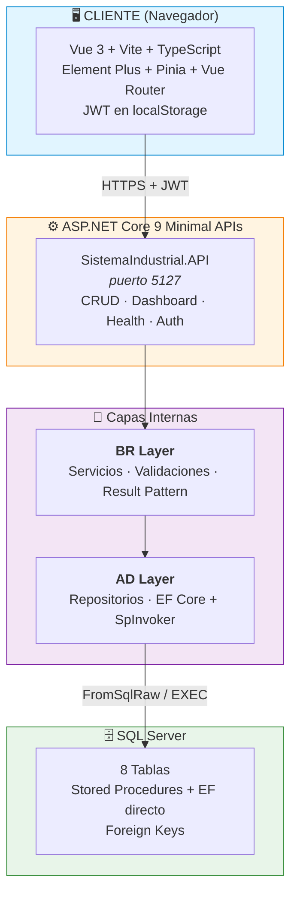
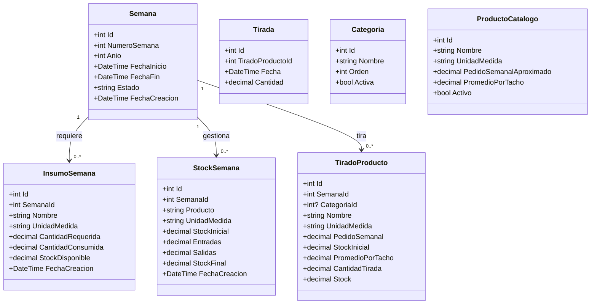
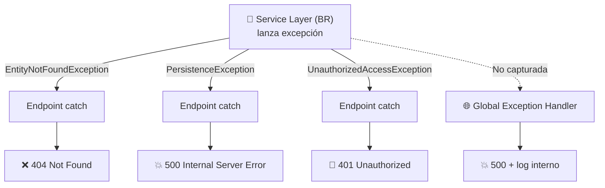
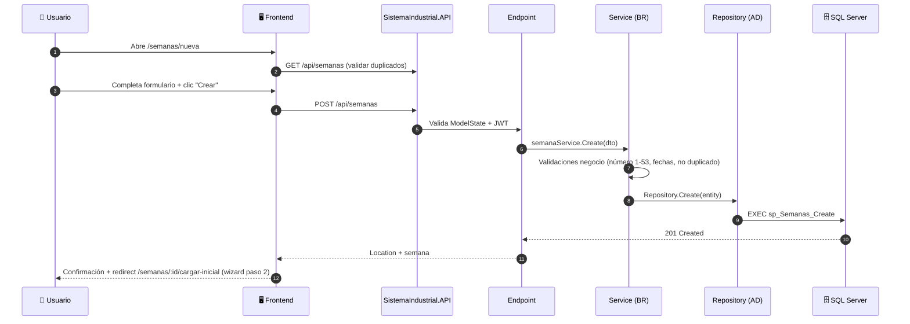
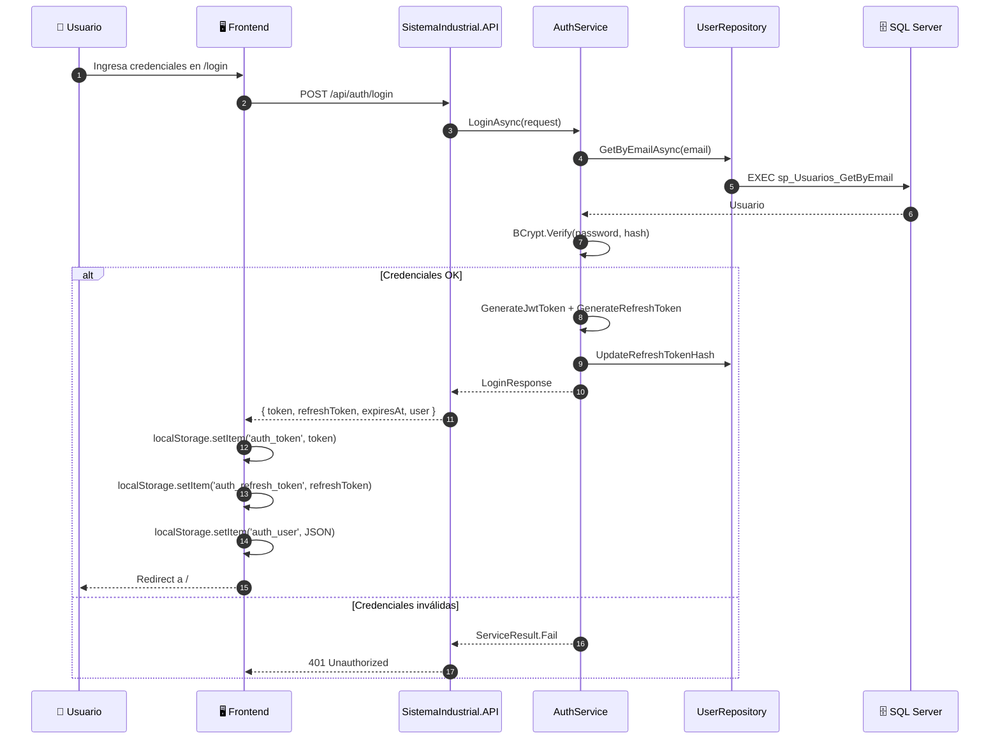

# Sistema Industrial — Gestión de Producción

> Documento de referencia técnica para desarrollo y evolución del proyecto.
> Última actualización: 2026-10-10 | Versión: 1.0.0

---

## Índice

1. [Concepto del Sistema](#1-concepto-del-sistema)
2. [Arquitectura General](#2-arquitectura-general)
3. [Estructura de Directorios](#3-estructura-de-directorios)
4. [Back-end — ASP.NET Core 9 + SQL Server](#4-back-end--aspnet-core-9--sql-server)
5. [Front-end — Vue 3 + TypeScript + Vite](#5-front-end--vue-3--typescript--vite)
6. [Paradigma y Metodología de Desarrollo](#6-paradigma-y-metodología-de-desarrollo)
7. [Flujo de Datos](#7-flujo-de-datos)
8. [Requisitos Funcionales y Técnicos](#8-requisitos-funcionales-y-técnicos)
9. [Observaciones Técnicas y Deuda Técnica](#9-observaciones-técnicas-y-deuda-técnica)
10. [Hoja de Ruta — Próximos Pasos](#10-hoja-de-ruta--próximos-pasos)
11. [Historial de Versiones](#11-historial-de-versiones)

---

## 1. Concepto del Sistema

El sistema es una **plataforma de gestión de producción industrial** que centraliza la administración de:

- **Semanas** — CRUD de semanas de producción (lunes a sábado) con validación de fechas, estado y wizard de carga inicial.
- **Productos** — Catálogo general de productos reutilizable por semana.
- **Insumos** — Control de insumos requeridos y consumidos por semana.
- **Stock** — Gestión de stock por semana, con sincronización desde Tirado.
- **Tirado / Armado** — Tiradas por producto/día (bulk create, edición de totales, filtros por estado, tachos por semana).
- **Categorías** — Catálogo de categorías de producto.
- **Dashboard** — Vista consolidada con métricas KPI y alertas.

> Módulos históricos **Objetivos** y **Registro Tacho** eliminados (flujo cubierto por Tirado/Tiradas).

El sistema expone un **panel interno** accesible por personal autorizado (login + JWT) para monitoreo y control de producción.

---

## 2. Arquitectura General (N-Tier: AD → BR → API)



**Capas del Backend (N-Tier):**
- **API Layer** (`SistemaIndustrial.API`): Auth, CRUD base, Dashboard, Health, Global Exception Handler
- **BR Layer** (`SistemaIndustrial.BR`): Servicios con lógica de negocio, validaciones, Result Pattern (`ServiceResult<T>`)
- **AD Layer** (`SistemaIndustrial.AD`): Repositorios tipados, **EF Core + Stored Procedures** (`SpInvoker` helpers), Entidades de dominio, `AppDbContext`

**Patrones aplicados:**
- **Backend**: Repository pattern, **EF Core + SPs** (FromSqlRaw + ToListAsync), DI, Result Pattern (`ServiceResult<T>`), Global Exception Handling, **SpInvoker** helper centralizado
- **Frontend**: Composition API + TypeScript, Componentes por vista, CSS modular, Route Guards, Composable `useAuth`, Pinia stores

---

## 3. Estructura de Directorios (Solution)

```
SistemaIndustrial.sln
├── SistemaIndustrial.AD/                    # Data Access Layer
│   ├── Data/                                # AppDbContext (EF Core)
│   ├── Interfaces/                          # IRepository, repositorios específicos
│   ├── Models/                              # Entidades: Semana, InsumoSemana, StockSemana, TiradoProducto, Tirada, Categoria, ProductoCatalogo, Usuario
│   ├── Repositories/                        # Repositorios (SPs vía SpInvoker + EF directo)
│   ├── SpInvoker.cs                         # Helpers EF Core para SPs
│   └── SistemaIndustrial.AD.csproj
│
├── SistemaIndustrial.BR/                    # Business Rules Layer
│   ├── DTOs/                                # ServiceResult<T>, DTOs específicos
│   ├── Interfaces/                          # IServices
│   ├── Services/                            # Servicios: Semana, Insumo, Stock, TiradoProducto, Categoria, ProductoCatalogo, Dashboard, Auth
│   └── SistemaIndustrial.BR.csproj
│
├── SistemaIndustrial.API/                   # API Principal
│   ├── Endpoints/                           # Extension methods por dominio
│   │   ├── AuthEndpoints.cs
│   │   ├── SemanaEndpoints.cs
│   │   ├── InsumoEndpoints.cs
│   │   ├── StockEndpoints.cs
│   │   ├── TiradoProductoEndpoints.cs
│   │   ├── CategoriaEndpoints.cs
│   │   ├── ProductoCatalogoEndpoints.cs
│   │   ├── DashboardEndpoints.cs
│   │   └── HealthEndpoints.cs
│   ├── Models/                              # ApiModels (LoginRequest, SemanaCreateDto, etc.)
│   ├── Program.cs                           # Composition root + DI + CORS + Global Exception Handler + JWT
│   ├── appsettings.json                     # ConnectionString (LocalDB)
│   ├── appsettings.Development.json         # ConnectionString (SQL Auth) + JWT
│   └── SistemaIndustrial.API.csproj
│
├── SistemaIndustrial.AD.Test/               # 6 unitarios: defaults + EF InMemory (MSTest)
├── SistemaIndustrial.BR.Test/               # 24 unitarios: validators + services con Moq (MSTest)
├── SistemaIndustrial.API.Test/              # 4 unitarios: DataAnnotations + wrappers (MSTest)
│
├── Frontend/                                # Vue 3 + TypeScript + Vite
│   ├── package.json
│   ├── vite.config.ts
│   ├── tsconfig.json
│   ├── .env                                 # VITE_API_URL=http://localhost:5127
│   └── src/
│       ├── components/                      # DataTable, FormField, KpiCard, Modal, Spinner, ChartContainer
│       ├── composables/                     # useAuth, useApiFetch, useToast, useResponsive
│       ├── router/                          # Vue Router + guards
│       ├── services/
│       │   └── api/                         # Servicios API por dominio
│       ├── stores/                          # Pinia stores por módulo
│       ├── types/                           # Interfaces TypeScript
│       ├── views/                           # Vistas por módulo (semanas, productos, insumos, stock, tirado, armado, dashboard, auth)
│       └── assets/styles/                   # CSS modular (base, layouts, components, views) + responsive
│
└── Docs/                                    # Documentación técnica completa
    ├── DATABASE/                            # Archivos modulares
    ├── DATABASE.md                          # Documento principal consolidado
    ├── sql/                                 # Scripts SQL
    ├── backend/                             # Docs backend
    ├── frontend/                            # Docs frontend
    └── versionado/                          # Historial de versiones
```

> **Nota**: Los scripts DDL se encuentran en `Docs/sql/` y la documentación completa en `Docs/DATABASE/`.

---

## 4. Back-end — ASP.NET Core 9 + SQL Server

### 4.1 Stack y Dependencias

| Paquete | Versión | Propósito |
|---------|---------|-----------|
| Microsoft.AspNetCore | 9.0 (SDK) | Framework web |
| Microsoft.AspNetCore.Authentication.JwtBearer | 9.0 | JWT Authentication |
| Microsoft.EntityFrameworkCore | 9.0.0 | ORM + FromSqlRaw |
| Microsoft.EntityFrameworkCore.SqlServer | 9.0.0 | Provider SQL Server |
| Microsoft.Data.SqlClient | 5.2.2 | Driver SQL Server (ADO.NET) |
| BCrypt.Net-Next | 4.0.3 | Hash de contraseñas |
| System.Text.Json | Built-in | Serialización |

**Target Framework**: net9.0  
**Características C#**: Nullable reference types, implicit usings, records.

---

### 4.2 Punto de Entrada: SistemaIndustrial.API/Program.cs

```csharp
// CORS para el front-end Vue
builder.Services.AddCors(options =>
{
    options.AddPolicy("VueCors", policy =>
    {
        policy.WithOrigins("http://localhost:5173")
              .AllowAnyHeader()
              .AllowAnyMethod()
              .AllowCredentials();
    });
});

// JSON Options
builder.Services.ConfigureHttpJsonOptions(options =>
{
    options.SerializerOptions.PropertyNameCaseInsensitive = true;
    options.SerializerOptions.PropertyNamingPolicy = JsonNamingPolicy.CamelCase;
});

// EF Core
var connectionString = builder.Configuration.GetConnectionString("SqlServer")
    ?? throw new InvalidOperationException("ConnectionStrings:SqlServer no configurado.");

builder.Services.AddDbContext<AppDbContext>(options =>
    options.UseSqlServer(connectionString));

// JWT Authentication
builder.Services.AddAuthentication(JwtBearerDefaults.AuthenticationScheme)
    .AddJwtBearer(options =>
    {
        options.TokenValidationParameters = new TokenValidationParameters
        {
            ValidateIssuer = true,
            ValidateAudience = true,
            ValidateLifetime = true,
            ValidateIssuerSigningKey = true,
            ValidIssuer = builder.Configuration["Jwt:Issuer"],
            ValidAudience = builder.Configuration["Jwt:Audience"],
            IssuerSigningKey = new SymmetricSecurityKey(
                Encoding.UTF8.GetBytes(builder.Configuration["Jwt:Key"]!))
        };
    });

builder.Services.AddAuthorization();

// Repositories (AD Layer)
builder.Services.AddScoped<ISemanaRepository, SemanaRepository>();
builder.Services.AddScoped<IInsumoRepository, InsumoRepository>();
builder.Services.AddScoped<IStockRepository, StockRepository>();
builder.Services.AddScoped<ITiradoProductoRepository, TiradoProductoRepository>();
builder.Services.AddScoped<ICategoriaRepository, CategoriaRepository>();
builder.Services.AddScoped<IProductoCatalogoRepository, ProductoCatalogoRepository>();

// Services (BR Layer)
builder.Services.AddScoped<ISemanaService, SemanaService>();
builder.Services.AddScoped<IInsumoService, InsumoService>();
builder.Services.AddScoped<IStockService, StockService>();
builder.Services.AddScoped<ITiradoProductoService, TiradoProductoService>();
builder.Services.AddScoped<ICategoriaService, CategoriaService>();
builder.Services.AddScoped<IProductoCatalogoService, ProductoCatalogoService>();
builder.Services.AddScoped<IDashboardService, DashboardService>();

// Middleware global de errores
app.UseExceptionHandler(errorApp =>
{
    errorApp.Run(async context =>
    {
        context.Response.StatusCode = 500;
        context.Response.ContentType = "application/json";
        var body = JsonSerializer.Serialize(new { error = "Ocurrió un error interno del servidor." });
        await context.Response.WriteAsync(body);
    });
});

// Pipeline
app.UseRouting();
app.UseCors("VueCors");
app.UseAuthentication();
app.UseAuthorization();
app.MapGet("/", () => "Backend Sistema Industrial corriendo correctamente!");
app.Run();
```

**Puertos (launchSettings.json):**
- `SistemaIndustrial.API`: HTTP `http://localhost:5127` | HTTPS `https://localhost:7244`

---

### 4.3 Modelos y Jerarquía de Entidades



---

### 4.4 Excepciones Personalizadas

Ubicadas en `SistemaIndustrial.AD/Exceptions/`.

#### EntityNotFoundException
```csharp
public class EntityNotFoundException : Exception
{
    public EntityNotFoundException(string message) : base(message) { }
    public EntityNotFoundException(string entityName, int id)
        : base($"{entityName} con Id {id} no fue encontrado.") { }
}
```

#### PersistenceException
```csharp
public class PersistenceException : Exception
{
    public PersistenceException(string message) : base(message) { }
    public PersistenceException(string message, Exception inner) : base(message, inner) { }
}
```

#### UnauthorizedAccessException
```csharp
public class UnauthorizedAccessException : Exception
{
    public UnauthorizedAccessException(string message) : base(message) { }
}
```

---

### 4.5 Data Transfer Objects (DTOs)

#### ServiceResult Pattern (BR Layer)
```csharp
public class ServiceResult
{
    public bool Success { get; set; }
    public string? Message { get; set; }
    
    public static ServiceResult Ok(string message = "Operación exitosa") => 
        new() { Success = true, Message = message };
    public static ServiceResult Fail(string message) => 
        new() { Success = false, Message = message };
}

public class ServiceResult<T>
{
    public bool Success { get; set; }
    public string? Message { get; set; }
    public T? Data { get; set; }
    
    public static ServiceResult<T> Ok(T data, string message = "Operación exitosa") => 
        new() { Success = true, Message = message, Data = data };
    public static ServiceResult<T> Fail(string message) => 
        new() { Success = false, Message = message };
}
```

#### ApiModels (API Layer)
```csharp
public record LoginRequest(string Email, string Password);
public record LoginResponse(string Token, string RefreshToken, DateTime ExpiresAt, UserInfo User);

public record UserInfo(int Id, string Email, string Nombre, string Role);

public record SemanaCreateDto(int NumeroSemana, int Anio, DateTime FechaInicio, DateTime FechaFin);
public record SemanaUpdateDto(int NumeroSemana, int Anio, DateTime FechaInicio, DateTime FechaFin, string Estado);
public record SemanaResponse(int Id, int NumeroSemana, int Anio, DateTime FechaInicio, DateTime FechaFin, string Estado);

// DTOs por módulo en `SistemaIndustrial.BR/DTOs/` (records Create/Update/Response + `ServiceResult<T>`)
```

---

### 4.6 Capa de Servicios (Business Rules Layer — SistemaIndustrial.BR)

#### Registro en DI Container
```csharp
// Repositories (AD Layer)
builder.Services.AddScoped<ISemanaRepository, SemanaRepository>();
builder.Services.AddScoped<IInsumoRepository, InsumoRepository>();
builder.Services.AddScoped<IStockRepository, StockRepository>();
builder.Services.AddScoped<ITiradoProductoRepository, TiradoProductoRepository>();
builder.Services.AddScoped<ICategoriaRepository, CategoriaRepository>();
builder.Services.AddScoped<IProductoCatalogoRepository, ProductoCatalogoRepository>();

// Services (BR Layer)
builder.Services.AddScoped<ISemanaService, SemanaService>();
builder.Services.AddScoped<IInsumoService, InsumoService>();
builder.Services.AddScoped<IStockService, StockService>();
builder.Services.AddScoped<ITiradoProductoService, TiradoProductoService>();
builder.Services.AddScoped<ICategoriaService, CategoriaService>();
builder.Services.AddScoped<IProductoCatalogoService, ProductoCatalogoService>();
builder.Services.AddScoped<IDashboardService, DashboardService>();
```

#### SpInvoker (Data Access Layer - SistemaIndustrial.AD)

Archivo: `SistemaIndustrial.AD/SpInvoker.cs`

Helper reutilizable para invocar Stored Procedures desde EF Core:

| Método | Uso | Retorna |
|--------|-----|---------|
| `QueryEntityAsync<T>(sql, params)` | `FromSqlRaw` + `ToListAsync()` | `List<T>` |
| `ExistsAsync(sql, params)` | Ejecuta SP de `Exists` (1/0) | `bool` |
| `ScalarInsertAsync(sql, params)` | Abre conexión, `ExecuteScalarAsync()` | `int` |
| `NonQueryAsync(sql, params)` | `ExecuteSqlRawAsync` | `int` |

**Regla de oro**: Nunca usar `FirstOrDefaultAsync()` sobre `FromSqlRaw`/`SqlQueryRaw` con `EXEC` — siempre `ToListAsync()` + filtrado en memoria.

---

### 4.7 Servicios CRUD (BR Layer)

**Servicios Implementados:**

| Servicio | Entidad | Validaciones Especiales |
|----------|---------|------------------------|
| `SemanaService` | Semana | Número 1-53, Año válido, lunes a sábado (6 días exactos), No duplicados |
| `InsumoService` | InsumoSemana | Semana existe, Cantidades >= 0, Stock no negativo |
| `StockService` | StockSemana | Semana existe, StockFinal = Inicial + Entradas - Salidas, SyncFromTirado |
| `TiradoProductoService` | TiradoProducto | Semana existe, Promedio > 0, bulk create, ajuste de tirada |
| `ProductoCatalogoService` | ProductoCatalogo | Nombre único, valores >= 0 |
| `CategoriaService` | Categoria | Nombre único |
| `DashboardService` | Métricas KPI | Agregaciones desde Tiradas, Alertas |

**Ejemplo: `SemanaService.Delete` (validación cruzada):**
```csharp
public async Task<ServiceResult> DeleteAsync(int id)
{
    if (!await _repository.ExistsAsync(id))
        return ServiceResult.Fail($"La semana con Id {id} no existe.");

    // Validación cruzada: no eliminar si tiene datos dependientes
    if (await _repository.HasDependentDataAsync(id))
        return ServiceResult.Fail("No se puede eliminar la semana porque tiene datos asociados.");

    await _repository.DeleteAsync(id);
    return ServiceResult.Ok("Semana eliminada correctamente.");
}
```

---

### 4.8 AuthService (Login + JWT)

**Archivo:** `SistemaIndustrial.BR/Services/AuthService.cs`  
**Interface:** `IAuthService`

```csharp
public interface IAuthService
{
    Task<ServiceResult<LoginResponse>> LoginAsync(LoginRequest request);
    Task<ServiceResult> RegisterAsync(RegisterRequest request);
    Task<ServiceResult> ChangePasswordAsync(int userId, string currentPassword, string newPassword);
    Task<UserInfo?> GetUserByIdAsync(int id);
    Task<bool> ValidateTokenAsync(string token);
}
```

#### LoginAsync (JWT)
```csharp
public async Task<ServiceResult<LoginResponse>> LoginAsync(LoginRequest request)
{
    var user = await _userRepository.GetByEmailAsync(request.Email);
    if (user == null) 
        return ServiceResult<LoginResponse>.Fail("Credenciales inválidas.");
    
    if (!BCryptNet.Verify(request.Password, user.PasswordHash)) 
        return ServiceResult<LoginResponse>.Fail("Credenciales inválidas.");

    var token = GenerateJwtToken(user);
    var refreshToken = GenerateRefreshToken();
    
    // Guardar refresh token en BD (hash)
    await _userRepository.UpdateRefreshTokenAsync(user.Id, BCryptNet.HashPassword(refreshToken));
    
    return ServiceResult<LoginResponse>.Ok(new LoginResponse(
        token, refreshToken, DateTime.UtcNow.AddHours(8),
        new UserInfo(user.Id, user.Email, user.Nombre, user.Role)));
}
```

- **JWT**: Expiración 8 horas, firma HMAC-SHA256
- **Refresh Token**: Expiración 7 días, rotación en cada uso
- **BCrypt**: workFactor 12

---

### 4.9 Endpoints API

Todos los endpoints:
- Reciben servicios por DI.
- Validan `ModelState.IsValid` en POST/PUT.
- Retornan 201 Created (con Location header) en POST.
- Requieren `[Authorize]` (política global), excepto Auth y Health.
- Encapsulan en try-catch tipado: `EntityNotFoundException`→404, `PersistenceException`→500, `UnauthorizedAccessException`→401, `Exception`→500.

#### SistemaIndustrial.API (puerto 5127)

| Módulo | Endpoints | Auth |
|--------|-----------|------|
| **Auth** | `POST /api/auth/login`, `POST /api/auth/refresh`, `POST /api/auth/logout` | Público |
| **Auth** | `POST /api/auth/register`, `PUT /api/auth/password` | Requiere JWT |
| **Semanas** | `GET/POST/PUT/DELETE /api/semanas` | Requiere JWT |
| **Productos** | `GET/POST/PUT/DELETE /api/productos` | Requiere JWT |
| **Insumos** | `GET/POST/PUT/DELETE /api/insumos` | Requiere JWT |
| **Stock** | `GET/POST/PUT/DELETE /api/stock`, `POST /api/stock/sync-from-tirado/{id}` | Requiere JWT |
| **Tirado** | `GET/POST/PUT/DELETE /api/tirado`, `PATCH /api/tirado/{id}/tirar`, `POST /api/tirado/semana/{id}/bulk` | Requiere JWT |
| **Categorías** | `GET/POST/PUT/DELETE /api/categorias` | Requiere JWT |
| **Dashboard** | `GET /api/dashboard/metricas/{id}`, `/tendencias`, `/alertas` | Requiere JWT |
| **Health** | `GET /health` | Público |

---

### 4.10 Base de Datos

SQL Server (Express / LocalDB / SQL Auth)

| Tabla | Columnas clave | Índices / Constraints |
|-------|----------------|----------------------|
| `Usuarios` | Id, Email, PasswordHash, Nombre, Role, RefreshTokenHash, RefreshTokenExpiry | PK Id, UNIQUE Email |
| `Semanas` | Id, NumeroSemana, Anio, FechaInicio, FechaFin, Estado, FechaCreacion | PK Id, UNIQUE (NumeroSemana, Anio) |
| `InsumosSemana` | Id, SemanaId, Nombre, UnidadMedida, CantidadRequerida, CantidadConsumida, StockDisponible, FechaCreacion | PK Id, FK SemanaId→Semanas |
| `StockSemana` | Id, SemanaId, Producto, UnidadMedida, StockInicial, Entradas, Salidas, StockFinal, FechaCreacion | PK Id, FK SemanaId→Semanas |
| `TiradoProductos` | Id, SemanaId, CategoriaId, Nombre, UnidadMedida, PedidoSemanal, StockInicial, PromedioPorTacho, CantidadTirada, Stock | PK Id, FK SemanaId→Semanas, UNIQUE (SemanaId, Nombre) |
| `Tiradas` | Id, TiradoProductoId, Fecha, Cantidad, Observaciones, FechaCreacion | PK Id, FK TiradoProductoId (CASCADE) |
| `Categorias` | Id, Nombre, Orden, Activa | PK Id, UNIQUE Nombre |
| `ProductosCatalogo` | Id, Nombre, UnidadMedida, PedidoSemanalAproximado, PromedioPorTacho, Activo, Observaciones | PK Id, UNIQUE Nombre |

**Notas clave:**
- **Soft delete** opcional en Usuarios: `Activo` bit
- **EF Core + SPs**: Repositorios invocan SPs vía `SpInvoker`
- **Fix crítico**: Nunca `.FirstOrDefaultAsync()` sobre `EXEC` → `.ToListAsync()` + `.FirstOrDefault()`

---

### 4.11 Configuración

**appsettings.json (base - LocalDB / Windows Auth):**
```json
{
  "ConnectionStrings": {
    "SqlServer": "Server=(localdb)\\MSSQLLocalDB;Database=SistemaIndustrialDB;Trusted_Connection=True;TrustServerCertificate=True;"
  },
  "Jwt": {
    "Key": "SistemaIndustrial@JWT#2026!ClaveSecretaMuyLarga$ParaFirmarTokens*32chars",
    "Issuer": "SistemaIndustrial",
    "Audience": "SistemaIndustrialClient"
  },
  "Logging": { "LogLevel": { "Default": "Information", "Microsoft.AspNetCore": "Warning" } },
  "AllowedHosts": "*"
}
```

**appsettings.Development.json (SQL Auth):**
```json
{
  "ConnectionStrings": {
    "SqlServer": "Server=localhost;Database=SistemaIndustrialDB;User Id=industrial_user;Password=Industrial2026;TrustServerCertificate=True;"
  },
  "Jwt": {
    "Key": "SistemaIndustrial@JWT#2026!ClaveSecretaMuyLarga$ParaFirmarTokens*32chars",
    "Issuer": "SistemaIndustrial",
    "Audience": "SistemaIndustrialClient"
  },
  "Cors": {
    "AllowedOrigins": ["http://localhost:5173"]
  },
  "Logging": { "LogLevel": { "Default": "Information", "Microsoft.AspNetCore": "Warning" } }
}
```

---

## 5. Front-end — Vue 3 + TypeScript + Vite

### 5.1 Stack y Dependencias (Versiones Exactas)

#### Producción
| Paquete | Versión | Propósito |
|---------|---------|-----------|
| vue | 3.5+ | Framework reactivo (Composition API + TypeScript) |
| vite | 7.0+ | Bundler & Dev Server |
| vue-router | 4.5+ | SPA Routing + Guards |
| pinia | 3.0+ | Estado global |
| element-plus | 2.11+ | Componentes UI |
| @element-plus/icons-vue | 1.1+ | Iconografía |

#### Desarrollo
| Paquete | Versión | Propósito |
|---------|---------|-----------|
| typescript | 5.6+ | Tipado estático |
| eslint | 9.31+ | Linting |
| prettier | 3.6+ | Formato |
| @vitejs/plugin-vue | 6.0+ | Plugin Vue para Vite |
| vite-plugin-vue-devtools | 8.0+ | DevTools en desarrollo |

---

### 5.2 Configuración

**.env:**
```env
VITE_API_URL=http://localhost:5127
```

**vite.config.ts**: alias `@` → `./src`, plugin Vue, devTools. Proxy Vite configurado para `/api` → `http://localhost:5127`.

**tsconfig.json**: strict mode, paths alias, Vue support.

---

### 5.3 Inicialización: main.ts

```typescript
import './assets/css/base/main.css'
import { createApp } from 'vue'
import { createPinia } from 'pinia'
import ElementPlus from 'element-plus'
import 'element-plus/dist/index.css'
import * as ElementPlusIconsVue from '@element-plus/icons-vue'
import App from './App.vue'
import router from './router'
import { setRouter } from '@/composables/useApiFetch'

const app = createApp(App)

app.use(createPinia())
app.use(router)
app.use(ElementPlus)

setRouter(router)

for (const [key, component] of Object.entries(ElementPlusIconsVue)) {
  app.component(key, component)
}

app.mount('#app')
```

---

### 5.4 Sistema de Rutas y Guards

**Archivo:** `src/router/index.ts`

| Ruta | Nombre | Componente | Meta | Props |
|------|--------|------------|------|-------|
| / | redirect → /semanas | - | - | - |
| /login | login | LoginView | - | - |
| /dashboard | dashboard | DashboardView | requiereAuth: true | - |
| /semanas | semanas | SemanasView | requiereAuth: true | - |
| /semanas/nueva | nueva-semana | NuevaSemanaView | requiereAuth: true | - |
| /semanas/:id | detalle-semana | DetalleSemanaView | requiereAuth: true | - |
| /semanas/:id/editar | editar-semana | EditarSemanaView | requiereAuth: true | - |
| /semanas/:id/cargar-inicial | cargar-inicial | CargarInicialSemanaView | requiereAuth: true | - |
| /semanas/:semanaId/insumos | insumos | InsumosView | requiereAuth: true | - |
| /semanas/:semanaId/stock | stock | StockView | requiereAuth: true | - |
| /semanas/:semanaId/tirado | tirado | TiradoView | requiereAuth: true | - |
| /semanas/:semanaId/tirado/tachos | tachos-semana | TachosSemanaView | requiereAuth: true | - |
| /semanas/:semanaId/armado | armado | ArmadoView | requiereAuth: true | - |
| /productos (+/nuevo, /:id/editar) | productos | ProductosView, etc. | requiereAuth: true | - |
| * | not-found | NotFoundView | - | - |

> Guard de autenticación comentado (modo demo, acceso libre).

**Guards globales (`router.beforeEach`):**
```typescript
router.beforeEach((to) => {
  const { isAuthenticated } = useAuth()
  const autenticado = isAuthenticated()

  if (to.meta.requiereAuth && !autenticado)
    return { name: 'login' }

  if (to.meta.soloInvitado && autenticado)
    return { name: 'home' }
})
```

---

### 5.5 Composable: useAuth.ts

```typescript
const TOKEN_KEY = 'auth_token'
const REFRESH_TOKEN_KEY = 'auth_refresh_token'
const USER_KEY = 'auth_user'

export function useAuth() {
  const getToken = () => localStorage.getItem(TOKEN_KEY)
  const getRefreshToken = () => localStorage.getItem(REFRESH_TOKEN_KEY)
  const getUser = () => {
    const raw = localStorage.getItem(USER_KEY)
    if (!raw) return null
    try { return JSON.parse(raw) } catch { return null }
  }

  const isAuthenticated = () => !!getToken()

  const guardarSesion = (token: string, refreshToken: string, user: UserInfo) => {
    localStorage.setItem(TOKEN_KEY, token)
    localStorage.setItem(REFRESH_TOKEN_KEY, refreshToken)
    localStorage.setItem(USER_KEY, JSON.stringify(user))
  }

  const cerrarSesion = () => {
    localStorage.removeItem(TOKEN_KEY)
    localStorage.removeItem(REFRESH_TOKEN_KEY)
    localStorage.removeItem(USER_KEY)
  }

  const authHeaders = () => {
    const token = getToken()
    return token
      ? { 'Content-Type': 'application/json', Authorization: `Bearer ${token}` }
      : { 'Content-Type': 'application/json' }
  }

  return { getToken, getRefreshToken, getUser, isAuthenticated, guardarSesion, cerrarSesion, authHeaders }
}
```

- Almacenamiento: `localStorage` (persistente).
- Logout: Limpia `localStorage` + redirect `/login`.
- `authHeaders()` devuelve header `Authorization: Bearer <JWT>` validado por backend.

---

### 5.6 Vistas por Módulo

| Módulo | Vistas | Rutas |
|--------|--------|-------|
| **Auth** | LoginView | `/login` |
| **Dashboard** | DashboardView | `/dashboard` |
| **Semanas** | SemanasView, NuevaSemanaView, EditarSemanaView, DetalleSemanaView, CargarInicialSemanaView | `/semanas`, `/semanas/nueva`, `/semanas/:id`, `/semanas/:id/editar`, `/semanas/:id/cargar-inicial` |
| **Productos** | ProductosView, NuevoProductoView, EditarProductoView | `/productos`, `/productos/nuevo`, `/productos/:id/editar` |
| **Insumos** | InsumosView, NuevoInsumoView | `/semanas/:semanaId/insumos...` |
| **Stock** | StockView, NuevoStockView | `/semanas/:semanaId/stock...` |
| **Tirado** | TiradoView, TachosSemanaView | `/semanas/:semanaId/tirado`, `.../tirado/tachos` |
| **Armado** | ArmadoView | `/semanas/:semanaId/armado` |
| **404** | NotFoundView | `/:pathMatch(.*)*` |

---

### 5.7 Estilos CSS (modular + responsive + tema oscuro)

```
src/assets/styles/
├── main.css                  # solo @imports
├── element-plus-dark.css     # override tema oscuro para Element Plus
├── base/
│   ├── fonts.css             # Google Fonts
│   ├── variables.css         # :root + breakpoints (--bp-mobile/tablet)
│   ├── reset.css
│   ├── typography.css        # + responsive
│   └── utilities.css
├── layouts/
│   ├── app-shell.css         # sidebar (fijo 220px / colapsado 64px / overlay mobile + hamburguesa)
│   └── section.css           # padding responsive
├── components/
│   ├── buttons.css / table.css / cards.css / forms.css
│   ├── modal.css / spinner.css / chart-container.css
└── views/
    ├── dashboard.css / tirado.css / tachos-semana.css / armado.css
```

**Principio:** una regla en un solo archivo (sin duplicaciones). Breakpoints: 640px mobile, 1024px tablet. Composable `useResponsive()` para fullscreen de modales y columnas condicionales en mobile.

---

### 5.8 Integración con la API

Base URL: `import.meta.env.VITE_API_URL` (configurado en `.env`)

Headers: `useAuth().authHeaders()` → devuelve header `Authorization: Bearer <JWT>`

Patrón estándar:
```typescript
const API = import.meta.env.VITE_API_URL
const { authHeaders } = useAuth()

const res = await fetch(`${API}/api/semanas`, { headers: authHeaders() })
if (!res.ok) throw new Error(`HTTP ${res.status}`)
const data = await res.json()
```

---

## 6. Paradigma y Metodología de Desarrollo

### 6.1 Paradigma: Programación Orientada a Objetos (POO)

#### Encapsulamiento
- `SpInvoker` encapsula EF Core + invocación de Stored Procedures.
- `AppDbContext` encapsula la configuración de EF Core y mapeo.

#### Herencia
- Entidades base con propiedades comunes (Id, FechaCreacion).

#### Polimorfismo
- Interfaces específicas (`ISemanaRepository`, `ITiradoProductoRepository`, etc.) permiten DI tipada por entidad.
- Servicios dependen de abstracción (`IServicio`), no implementación concreta.

---

### 6.2 Patrones Utilizados

| Patrón | Aplicación |
|--------|------------|
| **Repository** | Interfaces específicas por entidad + implementaciones tipadas |
| **Template Method** | `SpInvoker` define esqueleto para invocar SPs |
| **DTO** | `LoginResponse`, `SemanaResponse`, `ServiceResult<T>` desacoplan representación de dominio |
| **Scoped DI** | Servicios por request (thread-safe) |
| **Separación de capas** | Endpoints / Services / Models / DTOs / Exceptions |
| **Inyección de dependencias** | Constructores, no `new` directo |
| **Result Pattern** | `ServiceResult<T>` para éxito/fallo tipado |

---

### 6.3 Manejo de Errores — Estrategia por Capas



**Principios:**
- Ningún stack trace llega al cliente.
- Respuestas error siempre JSON: `{ "error": "..." }`.
- Middleware global `UseExceptionHandler` = red de seguridad final.

---

### 6.4 Convenciones de Código

| Convención | Detalle |
|------------|---------|
| **Validación declarativa** | Data Annotations en modelos |
| **Validación imperativa** | Validaciones en servicios BR |
| **Respuestas HTTP semánticas** | `200`, `201` (Location), `204`, `400`, `401`, `403`, `404`, `500` |
| **No exposición de internos** | `catch (Exception)` → mensaje controlado, nunca stack trace |
| **Null safety** | Propiedades requeridas inicializadas; `?` solo donde opcional |
| **Consistencia Id en PUT** | `id` de ruta usado, no del body |
| **Work factor BCrypt** | 12 (configurado en `AuthService`) |

---

## 7. Flujo de Datos

### Flujo: Crear Semana + carga inicial



### Flujo: Login + Acceso Dashboard



---

## 8. Requisitos Funcionales y Técnicos

### 8.1 Requisitos Funcionales

| ID | Módulo | Requisito | Estado |
|----|--------|-----------|--------|
| RF-01 | Semanas | CRUD + validación lunes-sábado + wizard carga inicial | ✅ |
| RF-02 | Productos | Catálogo general + CRUD | ✅ |
| RF-03 | Insumos | CRUD por semana + control stock | ✅ |
| RF-04 | Stock | CRUD por semana + fórmula StockFinal + sync desde Tirado | ✅ |
| RF-05 | Tirado | CRUD + tiradas por día + bulk + edición de totales | ✅ |
| RF-06 | Dashboard | KPIs, tendencias, alertas automáticas | ✅ |
| RF-07 | Auth | Login JWT + Refresh Token + BCrypt | 🔄 En desarrollo |
| RF-08 | Auth | Route Guards + Role-based access | 🔄 En desarrollo |

### 8.2 Requisitos Técnicos — Back-end
- .NET 9 SDK
- SQL Server (Express / LocalDB / Docker)
- EF Core 9 + SPs vía SpInvoker
- JWT Bearer Authentication
- CORS configurado para frontend

### 8.3 Requisitos Técnicos — Front-end
- Node.js 20+ / npm 10+
- `npm install` en `Frontend/`
- `npm run dev` → `http://localhost:5173`
- Backend en `http://localhost:5127`

---

## 9. Observaciones Técnicas y Deuda Técnica

### Deuda Técnica — Back-end

| Item | Prioridad | Estado |
|------|-----------|--------|
| Implementar Autenticación JWT completa | Crítica | 🔄 En progreso |
| Tests unitarios (AD, BR, API) | Alta | 🔄 Parcial: 34 unitarios en verde (ver `Docs/backend/11-testing/`) |
| Paginación en GetAll | Media | ❌ Pendiente |
| Logging estructurado (Serilog) | Media | ❌ Pendiente |
| Rate limiting en Auth | Media | ❌ Pendiente |
| Auditoría de cambios (CreatedBy, UpdatedBy) | Baja | ❌ Pendiente |

### Deuda Técnica — Front-end

| Item | Prioridad | Estado |
|------|-----------|--------|
| Implementar vistas CRUD restantes | Alta | ❌ Pendiente |
| Gráficos en Dashboard (Chart.js / ECharts) | Alta | ❌ Pendiente |
| Formularios reactivos con validación (VeeValidate / Zod) | Media | ❌ Pendiente |
| Tests E2E (Cypress / Playwright) | Media | ❌ Pendiente |
| Internacionalización (i18n) | Baja | ❌ Pendiente |

---

## 10. Hoja de Ruta — Próximos Pasos

1. **Completar Autenticación JWT** (Backend + Frontend)
2. **Tests de integración** (WebApplicationFactory) — los unitarios ya están (34 en verde)
3. **Desarrollar vistas CRUD faltantes** (Frontend)
4. **Dashboard con gráficos interactivos**
5. **Paginación y filtros en listados**
6. **Despliegue a producción (Docker + CI/CD)**

---

## 11. Historial de Versiones

| Versión | Fecha | Cambios |
|---------|-------|---------|
| 1.2.0 | 2026-10-12 | Catálogo de productos, wizard carga inicial, bulk create, sync Stock←Tirado, semanas lunes-sábado, responsive + tema oscuro Element Plus; eliminados Objetivos y Registro Tacho |
| 1.1.0 | 2026-10-11 | Módulo Tirado/Armado completo (TiradoProducto, vistas Tirado/Armado, filtros, tiradas acumulativas) |
| 1.0.0 | 2026-10-10 | Estructura inicial N-Tier, CRUD Semanas, documentación base |
| 0.1.0 | 2026-02-22 | Proyecto inicial monolítico (Backend/Controllers + Frontend básico) |

---