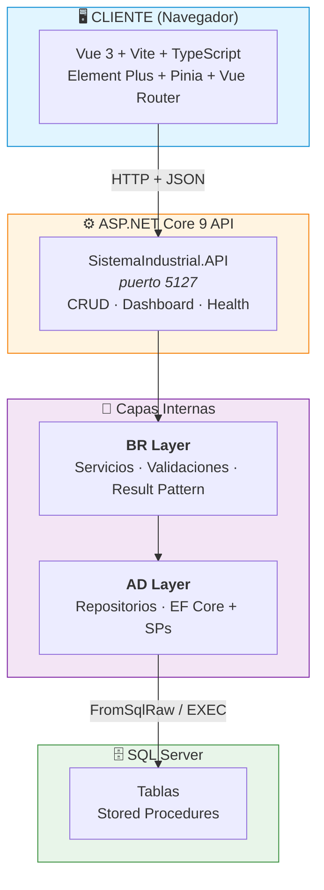

# 🏭 Sistema Industrial — Gestión de Producción

> Plataforma para la gestión de producción industrial: semanas de producción (lunes a sábado), catálogo de productos, insumos, stocks, tirado por producto/día y dashboard de métricas. Desarrollada con arquitectura **Frontend (Vue 3 + TypeScript) + Backend (ASP.NET Core 9 + EF Core + SQL Server)** en arquitectura **N-Tier (AD → BR → API)**.

---

## 📋 Descripción del Proyecto

Sistema web para la gestión de procesos industriales que centraliza:

| Módulo | Funcionalidad | Estado Backend | Estado Frontend |
|--------|---------------|----------------|-----------------|
| **Semanas** | CRUD de semanas (lunes a sábado) + wizard de carga inicial | ✅ | ✅ |
| **Productos** | Catálogo general de productos | ✅ | ✅ |
| **Insumos** | Control de insumos semanales | ✅ | ✅ |
| **Stock** | Gestión de stock semanal (sync desde Tirado) | ✅ | ✅ |
| **Tirado / Armado** | Tiradas por producto/día, bulk create, ajuste de stock | ✅ | ✅ |
| **Categorías** | Catálogo de categorías | ✅ | ✅ |
| **Dashboard** | Vista consolidada de métricas | ✅ | ✅ |

> Los módulos históricos **Objetivos** y **Registro Tacho** fueron eliminados (ver `Docs/sql/18_drop_registro_tacho.sql` y notas en `Docs/`).

---

## 🏗️ Arquitectura



**Capas del Backend (N-Tier):**
- **API Layer** (`SistemaIndustrial.API`): Endpoints, Middleware, DI, CORS, Global Exception Handler
- **BR Layer** (`SistemaIndustrial.BR`): Lógica de negocio, validaciones, Result Pattern
- **AD Layer** (`SistemaIndustrial.AD`): Repositorios, EF Core, Entidades de dominio

**Patrones aplicados:**
- **Backend**: Repository Pattern, EF Core + SPs, DI, Result Pattern, Global Exception Handling
- **Frontend**: Composition API, TypeScript, Componentes por vista, CSS modular, Route Guards

---

## 🛠️ Stack Tecnológico

### Frontend
| Tecnología | Versión | Uso |
|------------|---------|-----|
| Vue 3 | 3.5+ | Framework reactivo (Composition API + TypeScript) |
| Vite | 7.0+ | Bundler & Dev Server |
| Vue Router | 4.5+ | SPA Routing + Guards |
| Pinia | 3.0+ | Estado global |
| Element Plus | 2.11+ | Componentes UI |
| TypeScript | 5.6+ | Tipado estático |
| ESLint + Prettier | Latest | Linting & Formato |

### Backend
| Tecnología | Versión | Uso |
|------------|---------|-----|
| ASP.NET Core | 9.0 | Minimal APIs Framework |
| Entity Framework Core | 9.0 | ORM + FromSqlRaw para SPs |
| Microsoft.Data.SqlClient | 5.2+ | Driver SQL Server |
| BCrypt.Net-Next | 4.0+ | Hash de contraseñas |
| System.Text.Json | Built-in | Serialización |

### Base de Datos
- **SQL Server** (Express / LocalDB / SQL Auth)
- Tablas: `Semanas`, `InsumosSemana`, `StockSemana`, `TiradoProductos`, `Tiradas`, `Categorias`, `ProductosCatalogo`, `Usuarios`
- Stored Procedures para operaciones CRUD (módulos base) + EF Core directo (módulos nuevos)
- Connection Strings configurables en `appsettings.json` / `appsettings.Development.json`

---

## 📁 Estructura del Proyecto (Solution)

```
SistemaIndustrial.sln
├── SistemaIndustrial.AD/              # Data Access Layer
│   ├── Data/                          # AppDbContext (EF Core)
│   ├── Interfaces/                    # IRepository, repositorios específicos
│   ├── Models/                        # Entidades de dominio
│   ├── Repositories/                  # Implementaciones de repositorios
│   └── SistemaIndustrial.AD.csproj
│
├── SistemaIndustrial.BR/              # Business Rules Layer
│   ├── DTOs/                          # ServiceResult<T>, DTOs específicos
│   ├── Interfaces/                    # IServices
│   ├── Services/                      # Servicios de lógica de negocio
│   └── SistemaIndustrial.BR.csproj
│
├── SistemaIndustrial.API/             # API Principal (Minimal APIs)
│   ├── Endpoints/                     # Extension methods por dominio
│   ├── Models/                        # ApiModels (Request/Response DTOs)
│   ├── Program.cs                     # Composition root + DI + CORS + Global Exception Handler
│   ├── appsettings.json               # Config base (LocalDB)
│   ├── appsettings.Development.json   # Config desarrollo (SQL Auth)
│   └── SistemaIndustrial.API.csproj
│
├── SistemaIndustrial.AD.Test/         # Tests repositorios
├── SistemaIndustrial.BR.Test/         # Tests servicios
├── SistemaIndustrial.API.Test/        # Tests integración API
│
├── Frontend/                          # Vue 3 + Vite + TypeScript
│   ├── package.json
│   ├── vite.config.ts
│   ├── tsconfig.json
│   ├── .env                           # VITE_API_URL=http://localhost:5127
│   └── src/
│       ├── components/                # Componentes reutilizables
│       ├── composables/               # Lógica reactiva (useAuth, useApi)
│       ├── router/                    # Vue Router + guards
│       ├── services/                  # Servicios API por dominio
│       ├── stores/                    # Pinia stores
│       ├── types/                     # Tipos TypeScript
│       ├── views/                     # Vistas por módulo
│       └── assets/                    # Estilos, imágenes
│
└── Docs/                              # Documentación técnica completa
    ├── DATABASE/                      # Documentación BD modular
    ├── sql/                           # Scripts SQL oficiales
    ├── backend/                       # Docs backend
    ├── frontend/                      # Docs frontend
    └── versionado/                    # Historial de versiones
```

---

## 🚀 Inicio Rápido

### Prerrequisitos
- **.NET 9 SDK**
- **Node.js 20+** y **npm**
- **SQL Server** (Express, LocalDB, o contenedor Docker)

### 1. Base de Datos (SQL Server)
```bash
# Opción A: SQL Server Express / Developer Edition
# Conectar con SSMS / Azure Data Studio / VS Code
# Ejecutar scripts en Docs/sql/ en orden

# Opción B: LocalDB (desarrollo)
# Se crea automáticamente al ejecutar la API con appsettings.json
```

### 2. Configuración Backend
```json
// SistemaIndustrial.API/appsettings.Development.json
{
  "ConnectionStrings": {
    "SqlServer": "Server=localhost;Database=SistemaIndustrialDB;User Id=industrial_user;Password=Industrial2026;TrustServerCertificate=True;"
  },
  "Cors": {
    "AllowedOrigins": ["http://localhost:5173"]
  }
}
```

### 3. Ejecutar Backend
```bash
cd SistemaIndustrial.API
dotnet run --environment Development
# → http://localhost:5127
```

### 4. Configuración Frontend
```bash
# Frontend/.env (ya configurado)
VITE_API_URL=http://localhost:5127
```

### 5. Ejecutar Frontend
```bash
cd Frontend
npm install      # solo primera vez
npm run dev      # → http://localhost:5173
```

---

## 🔐 Autenticación (Próxima Implementación)

| Aspecto | Implementación Planificada |
|---------|----------------------------|
| **Login** | `POST /api/auth/login` → JWT Bearer Token |
| **Hash** | BCrypt `workFactor: 12` |
| **Token Storage** | `localStorage` / `sessionStorage` |
| **Route Guards** | `meta.requiereAuth` + JWT validation |
| **Roles** | `Admin` / `Operador` / `Supervisor` |

---

## 📡 API Endpoints Principales

| Módulo | Endpoints |
|--------|-----------|
| **Semanas** | `GET/POST/PUT/DELETE /api/semanas` |
| **Productos** | `GET/POST/PUT/DELETE /api/productos` |
| **Insumos** | `GET/POST/PUT/DELETE /api/insumos` |
| **Stock** | `GET/POST/PUT/DELETE /api/stock`, `POST /api/stock/sync-from-tirado/{semanaId}` |
| **Tirado** | `GET/POST/PUT/DELETE /api/tirado`, `PATCH /api/tirado/{id}/tirar`, `POST /api/tirado/semana/{semanaId}/bulk` |
| **Categorías** | `GET/POST/PUT/DELETE /api/categorias` |
| **Dashboard** | `GET /api/dashboard/metricas/{semanaId}`, `/tendencias`, `/alertas` |
| **Health** | `GET /health` |

**Códigos HTTP estándar:**
- `200 OK` — GET, PUT exitosos
- `201 Created` — POST (con `Location` header)
- `204 No Content` — DELETE
- `400 Bad Request` — Validación / FK inexistente
- `401 Unauthorized` — No autenticado
- `404 Not Found` — Recurso inexistente
- `500 Internal Server Error` — Error interno

---

## 🧪 Testing

### Tests Backend (34 unitarios en verde)
```bash
dotnet test SistemaIndustrial.sln
# SistemaIndustrial.BR.Test    → 24: validators + services (Moq)
# SistemaIndustrial.AD.Test    → 6: defaults + EF InMemory
# SistemaIndustrial.API.Test   → 4: DataAnnotations + wrappers
```
> Detener la API antes de compilar/testear (bloquea los DLL). Detalle en `Docs/backend/11-testing/01-tests-unitarios.md`.

### Scripts Disponibles

**Frontend:**
```bash
cd Frontend
npm run dev        # Servidor desarrollo (Vite)
npm run build      # Build producción
npm run preview    # Preview build
npm run lint       # ESLint + fix
npm run format     # Prettier
```

**Backend:**
```bash
dotnet run --environment Development    # Dev server
dotnet build                             # Compilar
dotnet test                              # Tests
```

---

## 📄 Documentación Técnica Completa

| Archivo | Descripción |
|---------|-------------|
| **README.md** | Este archivo - visión general |
| **PROYECTO.md** | Documento técnico de referencia |
| **Docs/DATABASE/** | 12 archivos modulares de BD |
| **Docs/DATABASE.md** | Documento principal consolidado BD |
| **Docs/sql/** | Scripts SQL oficiales |
| **Docs/backend/** | Documentación backend por categorías |
| **Docs/frontend/** | Documentación frontend |
| **Docs/versionado/** | Historial de versiones y migraciones |

---

## 👥 Autores

Desarrollado para gestión de procesos industriales (2026)

---

## 📄 Licencia

MIT — Uso industrial y educativo.